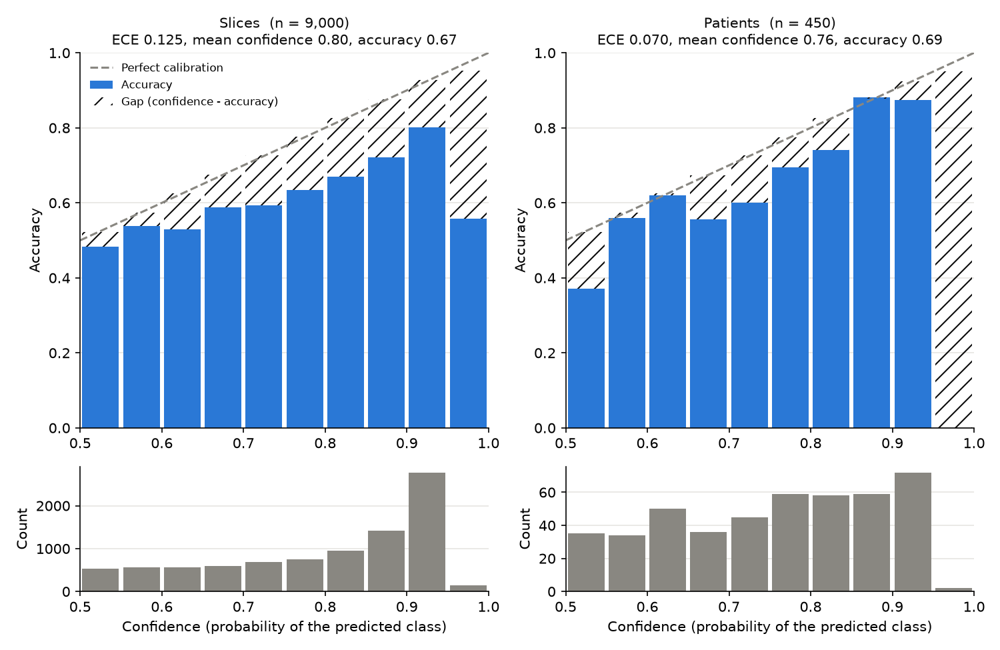
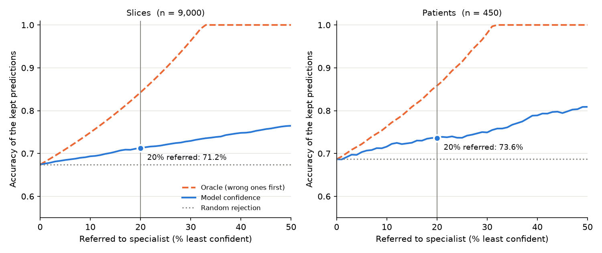
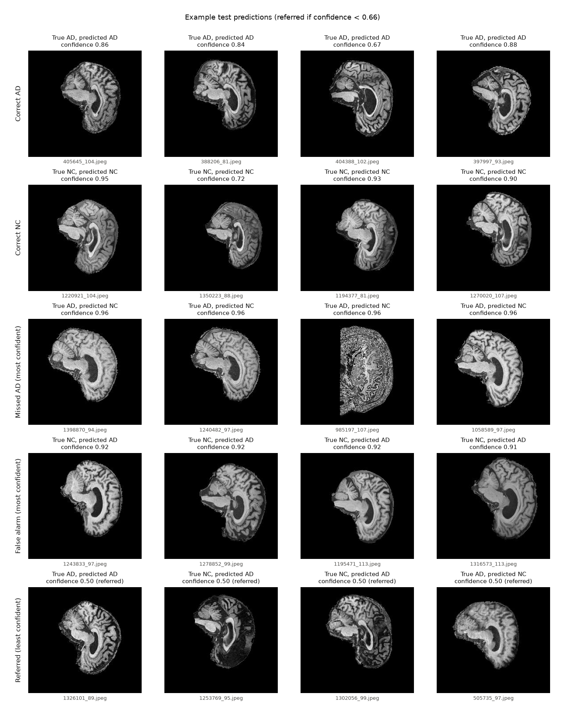
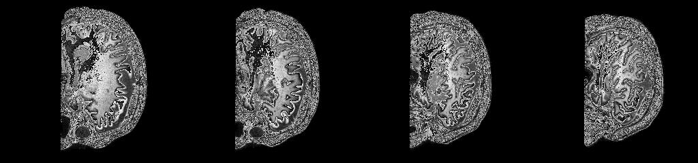

# ConvNeXt for Alzheimer's Disease Classification (ADNI)

## Description of Algorithm

### Step 1: Patchify Stem (Downsampling)

Once the slices have been loaded and normalised, the first layer of the network is the **stem**. It turns raw pixels into feature maps (`modules.py`, `downsample_layers[0]`):

```python
stem = nn.Sequential(
    nn.Conv2d(in_chans, dims[0], kernel_size=4, stride=4),
    LayerNorm(dims[0], eps=1e-6, data_format="channels_first")
)
```

**Input.** ADNI slices are 256×240 px greyscale JPEGs. `PadToSquare` adds 8 black rows at the top and bottom to make them 256×256 without stretching the brain. `ImageFolder` loads each slice as RGB, which copies the grey channel into 3 identical channels to match the stem's default `in_chans=3`. The input to the stem is therefore `(N, 3, 256, 256)`, where `N` is the batch size.

**Patchify convolution.** The 4×4 kernel with stride 4 moves 4 pixels at a time, so the patches don't overlap. The image is cut into a grid of 4×4 patches, and each patch becomes one 96-channel feature vector:

```
out = (in − kernel + 2·padding) / stride + 1 = (256 − 4 + 0) / 4 + 1 = 64
(N, 3, 256, 256)  →  (N, 96, 64, 64)
```

**LayerNorm (channels first).** At every pixel position of every image, the 96 channel values are normalised to mean 0 and variance 1, then scaled and shifted by learnable per-channel weights. Each position uses only its own statistics, so the result doesn't depend on the batch size or the other images in the batch (unlike BatchNorm). `channels_first` normalises over dimension 1 of the `(N, C, H, W)` tensor that `Conv2d` outputs. PyTorch's built-in `nn.LayerNorm` only normalises the last dimension, which is why `modules.py` defines its own `LayerNorm`. `eps=1e-6` stops a division by zero on flat regions such as the black background. The shape is unchanged: `(N, 96, 64, 64)`.

**Why these numbers.**

| Setting | Value | Reason |
|---|---|---|
| Kernel size and stride | 4 and 4 | Taken from Swin Transformer's 4×4 patches. The paper's ResNet-50 stem (7×7 conv stride 2 + max pool stride 2) also shrinks the image 4×, so swapping it for one simpler non-overlapping conv keeps the same resolution and slightly improved ImageNet accuracy (79.4% → 79.5%) [1]. ViT's 16×16 patches would leave only 16×16 positions, too coarse for small structures such as the hippocampus. |
| Output channels `dims[0]` | 96 | The channel width of ConvNeXt-T, matching Swin-T [1]. Each patch holds 16 grey pixels (48 values after the 3-channel copy), so 96 channels are enough to represent a patch without losing information. |
| LayerNorm after the stem | `eps=1e-6` | The paper adds a LayerNorm wherever the spatial resolution changes (after the stem and before each downsampling layer) to keep training stable [1]. |
| Input size | 256 | ADNI's native width, so no resizing is needed after padding. 256 is divisible by 32 (the stem's 4× times three later 2× downsamples), so every stage divides evenly: 64 → 32 → 16 → 8. The paper used 224 for ImageNet. |

**Why the stem is kept as in the paper for ADNI.**
- The 8 padding rows are exactly 2 patch rows, so no patch mixes padding with brain tissue.
- 96 channels are more than enough to hold each 4×4 greyscale patch, so the 4× downsampling loses no information at this step.
- `in_chans=1` would remove the copied channels. It isn't used because the network is trained from scratch, so three identical channels behave the same as one (the stem's weights for each channel simply add together). It would also add very little compute and would require changing timm's RGB augmentation pipeline and the cached normalisation statistics.
- Keeping the paper's stem keeps the comparison with the ConvNeXt-T benchmark [1] direct.

After the stem, the `(N, 96, 64, 64)` feature maps go into Stage 1: 3 ConvNeXt blocks, which keep the shape the same.

### Stages

The network has 4 **stages**. Each stage is a chain of ConvNeXt blocks working at one resolution and channel width (`modules.py`):

```python
for i in range(4):
    stage = nn.Sequential(
        *[Block(dim=dims[i], drop_path=dp_rates[cur + j],
        layer_scale_init_value=layer_scale_init_value) for j in range(depths[i])]
    )
    self.stages.append(stage)
    cur += depths[i]
```

- The list comprehension builds `depths[i]` blocks for stage `i`. Every block uses the same `Block` design. Only its width `dims[i]` differs between stages.
- `*` unpacks the list, because `nn.Sequential` takes layers as separate arguments (`nn.Sequential(b1, b2, b3)`), not as one list.
- `nn.Sequential` chains the blocks, so each block's output is the next block's input.
- `self.stages` is an `nn.ModuleList`, so PyTorch registers every block's weights for training, `.cuda()` and checkpoints.
- Each block gets its own drop path rate `dp_rates[cur + j]`. `cur` counts the blocks already built, so the rates continue from one stage to the next (see [Drop path](#drop-path-stochastic-depth)).

Blocks keep the input shape, so only the downsampling layers between stages change the resolution:

| Stage | Blocks | Channels | `dp_rates` indices | Shape (256 input) |
|---|---|---|---|---|
| 1 | 3 | 96 | 0–2 | 96 × 64 × 64 |
| 2 | 3 | 192 | 3–5 | 192 × 32 × 32 |
| 3 | 9 | 384 | 6–14 | 384 × 16 × 16 |
| 4 | 3 | 768 | 15–17 | 768 × 8 × 8 |

**Why 3, 3, 9, 3.** ResNet-50 uses (3, 4, 6, 3) blocks per stage. ConvNeXt changed this to Swin-T's 1:1:3:1 ratio, which puts most of the compute in Stage 3 and improved ImageNet accuracy [1]. At 16 × 16, Stage 3 keeps enough spatial detail while each block is still cheap. For ADNI, each Stage 3 position covers 16 × 16 px of the input slice. Its receptive field, the region of the input it can see, is much larger, about the scale of the hippocampus and ventricles.

**Kept as in the paper for now.** The stage loop works for any `depths` and `dims`, so smaller variants only need new model functions next to `convnext_tiny`. The first from-scratch run (27.8 M parameters) showed signs of overfitting: training accuracy kept rising to 85% while validation stalled at around 73–78%. Smaller ConvNeXt models are listed as a future experiment in `future_experiments.txt`.

### ConvNeXt Block

Every stage is built from the same `Block` (`modules.py`). Each block takes `(N, C, H, W)` and returns the same shape. Shapes below are for Stage 1 (C = 96, 64 × 64):

```python
def forward(self, x):
    input = x
    x = self.dwconv(x)               # 7×7 depthwise conv          (N, 96, 64, 64)
    x = x.permute(0, 2, 3, 1)        # channels last               (N, 64, 64, 96)
    x = self.norm(x)                 # LayerNorm                   (N, 64, 64, 96)
    x = self.pwconv1(x)              # Linear 96 → 384             (N, 64, 64, 384)
    x = self.act(x)                  # GELU                        (N, 64, 64, 384)
    x = self.pwconv2(x)              # Linear 384 → 96             (N, 64, 64, 96)
    if self.gamma is not None:
        x = self.gamma * x           # layer scale, per channel
    x = x.permute(0, 3, 1, 2)        # back to channels first      (N, 96, 64, 64)
    x = input + self.drop_path(x)    # residual connection
    return x
```

A block does two jobs, the same split as a Transformer block: first it mixes information across **positions** (the depthwise conv, in place of attention), then it mixes information across **features** (the MLP).

**1. Depthwise 7×7 convolution (spatial mixing).** `nn.Conv2d(dim, dim, kernel_size=7, padding=3, groups=dim)`.
- `groups=dim` makes it *depthwise*: each channel has its own 7×7 filter and only looks at itself, with no mixing between channels. This needs 96 × 7 × 7 weights instead of 96 × 96 × 7 × 7 for a normal conv.
- `kernel_size=7` lets each pixel see a 7 × 7 neighbourhood. ResNet uses 3 × 3. The paper raised it to 7, matching Swin's 7 × 7 attention window, and found no further gain from larger kernels [1].
- `padding=3` keeps the size the same: `(64 − 7 + 2·3) / 1 + 1 = 64`.
- On ADNI, a 7 × 7 window covers 28 × 28 px of the input slice at Stage 1, and 112 × 112 px at Stage 3, a large part of the brain.

**2. Permute to channels last.** `nn.Linear` acts on the last dimension, so the channels are moved to the end. A `1×1 Conv2d` on channels-first data is mathematically the same, but the authors found `Linear` on channels last slightly faster in PyTorch (block docstring). This is why the custom LayerNorm also has a `channels_last` mode.

**3. LayerNorm.** This is the block's only normalisation: each pixel's channels are normalised (see Custom LayerNorm). ResNet has a BatchNorm after every conv. ConvNeXt uses one LayerNorm per block, as Transformers do, and the paper found that fewer norms trained slightly better [1].

**4. Inverted bottleneck: Linear → GELU → Linear (channel mixing).**
- This is a small MLP applied to each pixel separately, with the same weights at every position. This is where the channels are combined, which the depthwise conv does not do.
- *Inverted bottleneck:* ResNet's bottleneck goes wide → narrow → wide. ConvNeXt goes narrow → wide (×4) → narrow (96 → 384 → 96), like a Transformer MLP and MobileNetV2. The wide middle layer gives room to learn combinations of features.
- *GELU* is a smooth version of ReLU, the activation used in Transformers. There is only one activation per block, where ResNet has one after every conv, and the paper found that fewer activations improved accuracy [1].
- These two layers hold most of the block's weights: about 74 k of the 79 k parameters in a Stage 1 block (dwconv 4,800 + norm 192 + pwconv1 37,248 + pwconv2 36,960 + gamma 96 = 79,296).

**5. Layer scale (`gamma`).** The branch's output is multiplied by one learnable value per channel, starting at 1e-6 (see [Layer scale](#layer-scale)). If `--layer_scale_init_value` is 0 or less, `gamma` is `None` and this step is skipped.

**6. Residual connection and drop path.** `x = input + self.drop_path(x)` adds the block's original input back, so the block only has to learn a *correction* to its input. Gradients can also flow straight back through the `+` across all 18 blocks, which makes the deep network trainable. During training, `drop_path` sometimes zeros the branch so the block is skipped for that image (see [Drop path](#drop-path-stochastic-depth)). With a rate of 0, it is `nn.Identity()` and does nothing.

**Why it is kept as in the paper for ADNI.** No part of the block depends on the dataset: every size comes from `dim`, and it works on whatever features the stem produces.
- The 7 × 7 kernel already covers structures such as the ventricles and hippocampus by Stage 3.
- LayerNorm, GELU and layer scale are there for training stability rather than for any property of the data.
- The depthwise conv keeps the CNN's local, translation-equivariant inductive bias, which suits a small dataset like ADNI better than attention.

Two block-related ideas are listed in `future_experiments.txt`:
- A higher drop path rate (0.2–0.3), to reduce the overfitting seen in the first run.
- Coordinate attention, as in CA-ConvNeXt [7]. Global average pooling discards *where* a feature was, but in brain MRI location matters (e.g. atrophy in the medial temporal lobe). This should only be tried once the overfitting is under control.

### Downsampling Between Stages

The other 3 entries of `downsample_layers` sit between the 4 stages. Each one runs after a stage finishes (`modules.py`):

```python
for i in range(3):
    downsample_layer = nn.Sequential(
        LayerNorm(dims[i], eps=1e-6, data_format="channels_first"),
        nn.Conv2d(dims[i], dims[i+1], kernel_size=2, stride=2),
    )
```

The loop runs for `i` = 0, 1, 2. Each layer takes `dims[i]` channels to `dims[i+1]` channels (`dims` has 4 entries, so only 3 transitions are possible):

| Layer | Runs after | Channels | Output shape (256 input) |
|---|---|---|---|
| Stem | input image | 3 → 96 | 96 × 64 × 64 |
| `downsample_layers[1]` | Stage 1 (3 blocks) | 96 → 192 | 192 × 32 × 32 |
| `downsample_layers[2]` | Stage 2 (3 blocks) | 192 → 384 | 384 × 16 × 16 |
| `downsample_layers[3]` | Stage 3 (9 blocks) | 384 → 768 | 768 × 8 × 8 |

Stage 4 (3 blocks) then works on the 768 × 8 × 8 maps before global average pooling and the classifier head.

**LayerNorm, then convolution.** The LayerNorm normalises each pixel's channels exactly as in the stem. Here it comes **before** the conv because its input is the output of a stage of residual blocks, whose values can drift as blocks add to them. The stem's input is already normalised by the data pipeline, so the stem normalises after its conv. The paper found that training became unstable with separate downsampling layers unless a LayerNorm was added wherever the resolution changes [1].

**2×2 convolution, stride 2.** This is a smaller non-overlapping patchify step. It halves the height and width, `(64 − 2) / 2 + 1 = 32`, and doubles the channels. ResNet downsamples inside its blocks with a stride-2 3×3 conv. ConvNeXt follows Swin Transformer and uses a separate 2×2 stride-2 layer, which improved ImageNet accuracy in the paper [1].

**Why halve the size and double the channels.** Each halving of height and width leaves 4× fewer positions, so doubling the channels keeps the compute per stage roughly balanced. This builds a feature pyramid: the network trades spatial detail (*where* something is) for feature detail (*what* it is). For ADNI, Stage 1 at 64 × 64 sees fine edges and tissue boundaries. Stages 3 and 4 at 16 × 16 and 8 × 8 have each position covering a large part of the slice (32 × 32 px of the input at Stage 4), so they can capture whole structures such as enlarged ventricles and atrophy in the medial temporal lobe.

**Why it is kept as in the paper for ADNI.** With the 256 input, every halving divides evenly (64 → 32 → 16 → 8), so no rows or columns are lost. The final 8 × 8 map is still fine enough for Grad-CAM to show which region of the brain the model used. The paper's ImageNet setting at 224 gives 7 × 7.

### Pooling, Final Norm and Classifier Head

After Stage 4, the features are turned into a single prediction per image (`modules.py`):

```python
self.norm = nn.LayerNorm(dims[-1], eps=1e-6)
self.head = nn.Linear(dims[-1], num_classes)
```

| Step | Code | Shape |
|---|---|---|
| Stage 4 output | | `(N, 768, 8, 8)` |
| Global average pooling | `x.mean([-2, -1])` in `forward_features` | `(N, 768)` |
| Final LayerNorm | `self.norm` | `(N, 768)` |
| Classifier head | `self.head` | `(N, 2)` |

**Global average pooling** averages each of the 768 channels over all 8 × 8 positions, giving one feature vector per image. Each channel then says how strongly its feature appears anywhere in the slice. The result doesn't depend on exactly where in the slice a feature appears, which helps with differences in head position and shape between patients. It also has no parameters, unlike flattening the 8 × 8 × 768 map into a large fully connected layer.

**Final LayerNorm.** `dims[-1]` is the last width, 768. The pooled vector is normalised to mean 0 and variance 1, plus a learnable scale and shift, so the classifier receives values in a stable range. This uses PyTorch's built-in `nn.LayerNorm` instead of the custom class: after pooling, the channels are the last dimension, which is what the built-in version normalises.

**Classifier head.** A fully connected layer maps the 768 features to `num_classes` = 2 scores (logits), one for AD and one for NC. During training, cross-entropy with label smoothing is applied to these logits. At test time, softmax turns them into probabilities, and that probability is the confidence score used for the reliability diagram and the reject threshold in the open research dilemma.

### Weight Initialisation

```python
self.apply(self._init_weights)

def _init_weights(self, m):
    if isinstance(m, (nn.Conv2d, nn.Linear)):
        trunc_normal_(m.weight, std=.02)
        nn.init.constant_(m.bias, 0)
```

`self.apply(fn)` runs `fn` on every layer in the model, recursively: the stem, the downsampling layers, all 18 blocks and the head. Only `Conv2d` and `Linear` layers are changed:
- **Weights** start as small random values from a normal distribution with standard deviation 0.02. Random values break symmetry: if every weight started equal, every channel would learn the same feature. Small values stop the outputs from growing too large through 18 residual blocks.
- **Truncated** means any value beyond ±2 standard deviations is redrawn, so no weight starts unusually large.
- **Biases** start at 0.

LayerNorms keep PyTorch's defaults (weight 1, bias 0), and each block's layer scale `gamma` stays at `--layer_scale_init_value` (1e-6). This is the same initialisation as ViT and Swin, and the paper uses it too [1]. It matters here because the model is trained from scratch: with no ImageNet weights, these random values are its only starting point.

### Custom LayerNorm (Channels First and Channels Last)

ConvNeXt uses LayerNorm on two tensor layouts, so `modules.py` defines its own `LayerNorm` class that supports both:

| Mode | Tensor shape | Used in | Channels are at |
|---|---|---|---|
| `channels_last` (default) | `(N, H, W, C)` | Inside each `Block`, after the permute for the `nn.Linear` layers | last dim |
| `channels_first` | `(N, C, H, W)` | Stem and downsampling layers, directly after or before a `Conv2d` | dim 1 |

**Why a custom class is needed.** PyTorch's built-in `F.layer_norm` has no option to choose the dimension. It always normalises over the **last** dimension(s), and `normalized_shape` must match them. On a conv output of shape `(2, 96, 64, 64)`, asking it to normalise the 96 channels fails:

```
F.layer_norm(x, (96,))
RuntimeError: Given normalized_shape=[96], expected input with shape [*, 96], but got input of size[2, 96, 64, 64]
```

Passing `(96, 64, 64)` runs, but it normalises C, H and W together, giving one mean per image instead of one per pixel, which is a different operation. The alternative is to permute to channels last, normalise and permute back, which costs 2 extra reshuffles of the tensor every time. The ConvNeXt authors instead compute the statistics over dim 1 directly:

```python
def forward(self, x):
    if self.data_format == "channels_last":
        return F.layer_norm(x, self.normalized_shape, self.weight, self.bias, self.eps)
    elif self.data_format == "channels_first":
        u = x.mean(1, keepdim=True)
        s = (x - u).pow(2).mean(1, keepdim=True)
        x = (x - u) / torch.sqrt(s + self.eps)
        x = self.weight[:, None, None] * x + self.bias[:, None, None]
        return x
```

- **`channels_last`** passes straight to the fast built-in function.
- **`u` and `s`** are the mean and variance of the C channel values at each pixel. `keepdim=True` keeps shape `(N, 1, H, W)`, so one mean and variance per pixel broadcasts across all C channels.
- **`s`** divides by C (not C − 1), the same definition `F.layer_norm` uses, so both modes give the same result. `eps` stops a division by zero where all channels are equal, such as on the black background.
- **`self.weight[:, None, None]`** reshapes the per-channel scale from `(C,)` to `(C, 1, 1)`. Without that, PyTorch would match `(C,)` against the last dimension (W) and scale the wrong axis. The same applies to the bias.

For example, a pixel with channel values `[2, 4, 6]` has mean 4 and standard deviation 1.63, so it becomes `[−1.22, 0, 1.22]`. A pixel with `[100, 200, 300]` gives the same result. The pattern across channels is kept, but the overall scale is removed. Each pixel is normalised using only its own channels, so unlike BatchNorm the result doesn't depend on the batch size or on the other images in the batch.

## Problem

## How it Works
1. Run `main.py` from this directory:

   ```bash
   python3 main.py
   ```

   Any of the variables below can be overridden on the command line, e.g.

   ```bash
   python3 main.py --batch_size 32 --epochs 100 --data_path /path/to/AD_NC/train
   ```

   These defaults have been fine-tuned to give the best performing model for classifying MRI scans as AD (Alzheimer's disease) or NC (normal control). Boolean flags take a value, e.g. `--model_ema True`.

### Training

| Argument | Default | Purpose |
|---|---|---|
| `--batch_size` | `64` | Number of images per batch (per GPU). |
| `--epochs` | `60` | Number of passes over the training set (see [Learning rate schedule](#learning-rate-schedule)). |
| `--update_freq` | `1` | Gradient accumulation steps; the effective batch size is `batch_size × update_freq`. |
| `--start_epoch` | `0` | Epoch to start from (used when resuming training). |
| `--seed` | `0` | Random seed for reproducibility. |
| `--device` | `cuda` | Device to train/evaluate on (`cuda` or `cpu`). |
| `--num_workers` | `4` | Number of DataLoader worker processes for loading images. |
| `--pin_mem` | `True` | Pin CPU memory in the DataLoader for faster transfer to the GPU. |

#### Mixed precision (AMP) and loss scaling

Training always uses automatic mixed precision (AMP), so `main.py` requires a CUDA GPU and stops with a message otherwise. The forward pass runs inside `torch.amp.autocast('cuda')` (`train.py`), so most of the maths is done in **float16** instead of float32. On an RTX GPU this is much faster and uses about half the memory. There is no full-precision training option. `evaluate` keeps a `use_amp` switch so that `predict.py` can score a trained model on a CPU in float32.

**The problem.** float16 has a very limited range. Its smallest normal value is about 6e-5, and many gradients are smaller than that. In float16 they round to 0 (*underflow*), and those weights stop learning.

**The loss scaler.** `NativeScaler` in `main.py` is `NativeScalerWithGradNormCount` (`utils.py`), a wrapper around PyTorch's `GradScaler`. Each training step it:
1. **Scales up:** multiplies the loss by a large factor (starting at 65,536) before `backward()`. By the chain rule, every gradient is multiplied by the same factor, lifting tiny gradients above float16's limit.
2. **Unscales:** divides the gradients back to their true size before the optimiser uses them.
3. **Measures:** computes the gradient norm (`grad_norm` in the training log), and clips the gradients if `--clip_grad` is set.
4. **Steps safely:** checks for `inf` or `NaN` gradients. If the factor was too large and a gradient overflowed, that update is **skipped** instead of corrupting the weights.
5. **Adjusts:** halves the factor after an overflow and slowly raises it again after many successful steps, settling on the largest factor that is safe.

This can be seen at the start of the first run's log:

```
Epoch: [0]  [ 10/571]  ...  grad_norm: 16.8804 (inf)
```

The running average of `grad_norm` is `inf` because the starting factor of 65,536 overflowed in the first few steps. Those updates were skipped and the factor was reduced. This is normal and harmless.

The scaler's current factor is saved in each checkpoint and restored with `--auto_resume`.

### Model

| Argument | Default | Purpose |
|---|---|---|
| `--model` | `convnext_tiny` | Name of the model architecture to train (a model function in `modules.py`). |
| `--input_size` | `256` | Height and width (pixels) images are resized to before entering the network. |
| `--drop_path` | `0.1` | Stochastic depth rate (randomly drops residual blocks during training for regularisation). See below. |
| `--layer_scale_init_value` | `1e-6` | Initial value of ConvNeXt's per-channel layer scale parameters. See below. |
| `--nb_classes` | `2` | Number of output classes (AD and NC). |

#### Drop path (stochastic depth)

Each ConvNeXt block has two paths: a **residual branch** (the block's convolutions and layers, which learn features) and a **shortcut** that carries the input forward unchanged. Their outputs are added, `output = input + branch(input)`, so each block learns a correction on top of its input.

During training, drop path randomly discards the residual branch for individual images, so `output = input` and that block is skipped for that image. The skip probability rises linearly with depth, from 0 for the first block to `--drop_path` for the last. Early blocks learn basic features such as edges and are rarely skipped. Deep blocks are skipped most often. At test time every block always runs.

The per-block rates are set in `modules.py`:

```python
dp_rates=[x.item() for x in torch.linspace(0, drop_path_rate, sum(depths))]
```

`sum(depths)` = 3 + 3 + 9 + 3 = 18 blocks, so `torch.linspace` gives 18 evenly spaced rates from 0 to `--drop_path`, including both ends (a step of 0.1 / 17 ≈ 0.0059). `.item()` turns each one from a 1-element tensor into a Python float. A counter `cur` tracks how many blocks have already been built, so `dp_rates[cur + j]` gives each block its own rate. A rate of 0 makes `DropPath` an `nn.Identity()`, so the first block is never skipped.

| Stage | Blocks | Drop path rates (`--drop_path 0.1`) |
|---|---|---|
| 1 | 1–3 | 0.000 – 0.012 |
| 2 | 4–6 | 0.018 – 0.029 |
| 3 | 7–15 | 0.035 – 0.082 |
| 4 | 16–18 | 0.088 – 0.100 |

Because the network can't rely on any single deep block, it overfits less. This matters for ADNI: the training slices come from only about a thousand patients (20 slices each), and neighbouring slices are very similar. `0.1` is the value the ConvNeXt paper uses for ConvNeXt-T [1]. Try `0.2`–`0.3` if validation accuracy falls well behind training accuracy.

#### Layer scale

Layer scale multiplies each block's residual branch by a learnable vector `gamma`, with one value per channel: `output = input + gamma * branch(input)`. Every value in `gamma` starts at `--layer_scale_init_value` and is learned during training like any other weight.

Starting at `1e-6` means each branch adds almost nothing at first, so the 18-block network begins close to an identity mapping (`output ≈ input`). Each block then "switches on" gradually as its `gamma` grows. This keeps early training stable: without it, the randomly initialised branches of all 18 blocks add noise together from the first step, which can cause large, unstable gradients at a high learning rate such as `4e-3`. The per-channel values also let the network learn how much each feature in each block should contribute.

`1e-6` is the value from the ConvNeXt paper [1].

### Exponential Moving Average (EMA)

| Argument | Default | Purpose |
|---|---|---|
| `--model_ema` | `False` | Keep an exponential moving average of the model weights. |
| `--model_ema_decay` | `0.9997` | Decay rate of the EMA weights (paper: `0.9999`; see below). |
| `--model_ema_force_cpu` | `False` | Store the EMA model on the CPU to save GPU memory. |
| `--model_ema_eval` | `False` | Also evaluate the EMA model on the validation set during training. |

EMA keeps a **second copy of the model** whose weights are a slow running average of the trained weights. The real model is trained as normal. After every optimizer step (`train.py`), the EMA copy is updated:

```
ema_weights = decay × ema_weights + (1 − decay) × current_weights
```

The EMA copy is never trained directly, so it changes slowly and smooths out the step-to-step noise in the weights. An averaged model often generalises slightly better than the weights from any single step. With `--model_ema_eval True`, the EMA copy is also evaluated on validation every epoch and its best version is saved as `checkpoint-best-ema.pth`.

**Why it could help on ADNI.** In the first from-scratch run, validation accuracy jumped between about 73% and 78% from epoch to epoch. The best checkpoint (80.9% validation) reached only 67.4% on test, which suggests it was a lucky peak. Because an EMA model changes slowly, its validation curve is smoother, and its best checkpoint is a more reliable choice.

**Why the default decay is 0.9997, not the paper's 0.9999.** An EMA averages over roughly `1 / (1 − decay)` optimizer steps. What matters is how long that window is compared with the whole training run:

| | ImageNet (paper) | ADNI, decay 0.9999 | ADNI, decay 0.9997 |
|---|---|---|---|
| Optimizer steps per epoch | ~313 (1.28 M images, batch 4096) | 285 (571 batches of 32, `update_freq 2`) | 285 |
| Epochs | 300 | 100 | 100 |
| Averaging window | 10,000 steps ≈ 32 epochs | 10,000 steps ≈ 35 epochs | 3,333 steps ≈ 12 epochs |
| Share of training | **~11%** | **35%** | **~12%** |
| Random initial weights left at the end | ≈ 0% | **≈ 6%** (0.9999^28,500) | ≈ 0.02% |

The EMA starts from the random initial weights. With the paper's 0.9999, the ADNI run is too short for the average to forget them: about 6% of the final EMA would still be random initial weights, and it would lag about a third of the run behind the trained model. 0.9997 keeps the same proportion as the paper (an averaging window of about 11–12% of training). EMA stays **off by default** (`--model_ema False`) because it hasn't been tested on ADNI yet. To try it:

```bash
python3 main.py --model_ema True --model_ema_eval True
```

### Optimisation

| Argument | Default | Purpose |
|---|---|---|
| `--opt_eps` | `1e-8` | AdamW epsilon (numerical stability term). |
| `--opt_betas` | `None` | AdamW betas; `None` uses PyTorch's defaults `(0.9, 0.999)`. |
| `--clip_grad` | `None` | Maximum gradient norm; `None` disables gradient clipping. |
| `--lr` | `5e-4` | Peak learning rate (see below). |
| `--min_lr` | `1e-6` | Lowest learning rate reached by the cosine schedule. |
| `--warmup_epochs` | `5` | Number of epochs the learning rate linearly warms up to `--lr`. |
| `--warmup_steps` | `-1` | Number of warm-up steps; overrides `--warmup_epochs` if greater than 0. |
| `--weight_decay` | `0.05` | Weight decay (L2 regularisation strength). |
| `--weight_decay_end` | `None` | Final weight decay for the cosine weight decay schedule; `None` keeps it constant. |

**Batch size and learning rate.** The default batch is 64 images per optimizer step (`--batch_size 64 --update_freq 1`). This fits on the RTX 3080 (about 6.5 GB). Gradient accumulation (`--update_freq` > 1) is only needed if a batch doesn't fit in GPU memory. ConvNeXt uses LayerNorm, which treats each image independently, so 2 batches of 32 accumulated give the same gradient as 1 batch of 64, only slower.

The paper's learning rate of `4e-3` is for a batch of 4096, so it has to be scaled down for a batch of 64:
- Linear scaling (the paper's rule) gives 4e-3 × 64 / 4096 = 6.25e-5.
- Square-root scaling, often used with Adam-type optimisers, gives 4e-3 × √(64 / 4096) = **5e-4**.

`5e-4` is the starting default. It hasn't been tuned on ADNI yet, and a learning-rate sweep (e.g. 2.5e-4, 5e-4, 1e-3, 2e-3 with everything else fixed) is the next planned experiment.

#### Learning rate schedule

`utils.cosine_scheduler` builds a list with one learning rate per optimizer step for the whole run (epochs × steps per epoch, e.g. 60 × 285 = 17,100). Every step, `train.py` sets the optimiser's learning rate from it.

1. **Linear warmup** (`--warmup_epochs`): the LR rises in a straight line from 0 to `--lr`. With random starting weights, the first gradients are large and unreliable, and Adam's running averages start at zero. A full-size LR straight away could push the weights somewhere bad that the model never recovers from. This matters more here than in fine-tuning, because the model is trained from scratch.
2. **Cosine decay** (the rest of the run): `min_lr + 0.5 × (lr − min_lr) × (1 + cos(π × i / N))`, where `i` counts steps since the end of warmup and `N` is the number of steps left after warmup. The LR falls slowly at first, fastest in the middle, and slowly again as it reaches `--min_lr` (1e-6) at the last step. Early on, a high LR takes big exploring steps. Near the end, a low LR takes small steps that settle the weights into a good minimum. Only the peak `--lr` needs tuning. The paper uses the same schedule [1].

A schedule that lowers the LR when validation stops improving (ReduceLROnPlateau) is not used, because ADNI validation accuracy jumps by about ±3% between epochs, and the schedule would react to noise.

**Why 60 epochs and 5 warmup epochs.** Cosine ties the LR to the total run length, so the number of epochs decides *when* the low-LR settling phase happens. In the first from-scratch run (100 epochs, 10 warmup), validation stopped improving after about epoch 30 and peaked at epoch 55 (80.9%), while the LR was still about half its peak. By the low-LR end, the model had already started overfitting, and validation finished at 76.7%. Shortening the run to 60 epochs makes the decay finish around where the model stopped improving, so the final, most settled weights are also the best ones. 5 warmup epochs is about 8% of the run, close to the paper's 20 of 300 epochs (7%). The 60 epochs will be checked by the learning-rate sweep, which uses these defaults.

#### Weight decay schedule

```python
if args.weight_decay_end is None:
    args.weight_decay_end = args.weight_decay
wd_schedule_values = utils.cosine_scheduler(
    args.weight_decay, args.weight_decay_end, args.epochs, num_training_steps_per_epoch)
```

**What weight decay does.** Each step, AdamW shrinks every decayed weight slightly towards 0:

```
w ← w − lr × weight_decay × w
```

This stops weights from growing large to memorise individual training images, so it acts as a regulariser against overfitting. It applies only to the `decay` parameter group (conv and Linear weights). Every step, `train.py` sets the scheduled value only on groups whose weight decay is already above 0, so biases, LayerNorm parameters and `gamma` stay at 0 (see [Parameter groups](#optimiser-adamw)).

**The schedule.** `main.py` uses the same cosine function as the learning rate, without warmup, to give one weight decay value per step. By default `--weight_decay_end` is `None`, so the end value is set equal to the start value. The "cosine" from 0.05 to 0.05 is then a flat line: weight decay is a constant **0.05**, as in the paper [1]. The startup log confirms this with `Max WD = 0.0500000, Min WD = 0.0500000`. Because the update is multiplied by `lr`, the actual amount of shrinking still follows the learning rate schedule: it ramps up during warmup and fades during the cosine decay.

**When it would change.** Setting `--weight_decay_end` makes weight decay follow a cosine curve between the two values. For example, `--weight_decay 0.04 --weight_decay_end 0.4` increases it over training, which some later self-supervised work (e.g. DINO) uses to regularise more strongly towards the end. ConvNeXt keeps it constant, so it's left off here.

**For ADNI.** 0.05 is the paper's value for ImageNet, which has 1.28 M images. The first from-scratch ADNI run overfitted, so a constant but higher weight decay (e.g. `--weight_decay 0.1`) is a simpler next step than scheduling it. Like the other regularisation experiments, it should be tested after the learning rate sweep, because the strength of weight decay depends on `lr` (`lr × weight_decay`).

#### Optimiser: AdamW

The optimiser is always **AdamW** (`optim_factory.py`). The original repository's `optim_factory.py` could build about 20 optimisers. It has been cut down to AdamW only, and the `--opt` and `--momentum` arguments were removed.

**Why AdamW.**
- **ConvNeXt was designed and tuned with it.** The paper trains every model with AdamW [1], and its other settings (layer scale, LayerNorm, warmup + cosine schedule, weight decay 0.05) were chosen together with it. Switching optimiser would mean re-tuning all of them.
- **Adaptive step size per weight.** Adam keeps running averages of each weight's gradient (momentum) and squared gradient, and divides the step by the square root of the second one. Weights with consistently large gradients take smaller steps, and weights with small gradients take larger ones. This matters for ConvNeXt, whose parameters have very different scales: 7×7 depthwise filters, large Linear layers, and layer scale `gamma` values that start at 1e-6. Plain SGD uses one step size for every weight, which is why Transformer-style models such as ConvNeXt train poorly with it.
- **Decoupled weight decay (the "W").** In plain Adam, weight decay is added to the gradient and then divided by the adaptive scaling, so it ends up weaker for some weights than others. AdamW shrinks the weights directly, separate from the gradient step, so `--weight_decay 0.05` acts as a consistent regulariser. This matters on ADNI because the first run overfitted.
- **Other optimisers don't suit this setup.** LAMB and LARS are designed for batches in the thousands, and SGD would undo the paper's tuning. For this project, the learning rate and weight decay *used with* AdamW matter more than the choice of optimiser.

**Parameter groups (`get_parameter_groups`).** Every learnable tensor in the model is put in one of two groups:

| Group | Which parameters | Weight decay | Tensors (ConvNeXt-T) |
|---|---|---|---|
| `decay` | Conv and Linear weights (2-D or more) | `--weight_decay` (0.05) | 59 |
| `no_decay` | Biases, LayerNorm weights and biases, layer scale `gamma` (all 1-D) | 0 | 123 |

Weight decay pulls weights towards 0. That is useful on the conv and Linear weights, which hold what the network has learned and are where overfitting happens. It would be harmful on the 1-D parameters: LayerNorm scales start at 1 and `gamma` controls how much each block contributes, so shrinking them would interfere with the network's normalisation and layer scaling. Biases only shift values and add very little capacity. This is the standard practice used by the paper's code. Because each group sets its own weight decay, AdamW's global `weight_decay` is set to 0.

Each group also carries `lr_scale = 1`, so every layer uses the full learning rate. Every step, `train.py` sets each group's learning rate to the schedule value × `lr_scale`. The `lr` passed to AdamW is only the starting value.

### Training Loop (`train.py`)

`main.py` calls `train_one_epoch` once per epoch. Each call makes one pass over the training set and returns that epoch's average metrics, which are written to `log.txt`. After each epoch, `main.py` calls `evaluate` on the validation set and saves `checkpoint-best.pth` if validation accuracy improved.

**Setup.** `model.train(True)` puts the model in training mode. In ConvNeXt, the only layer that behaves differently in training is DropPath, which randomly skips blocks only during training. `evaluate` calls `model.eval()`, so every block always runs at validation and test time. A `MetricLogger` keeps running averages of the loss, accuracy, learning rate and gradient norm, and prints a progress line to `train.log` every 10 batches:

```
Epoch: [0]  [ 10/571]  eta: 0:03:47  lr: 0.000001  loss: 0.7665 (0.7708)  class_acc: 0.5000 (0.5227) ...
```

The value in brackets is the average so far in that epoch. The learning rate is shown as its current value instead of an average. `optimizer.zero_grad()` clears any leftover gradients before the first batch, because PyTorch adds new gradients to existing ones instead of replacing them.

**Batches and steps.** The training loader shuffles the slices every epoch and gives batches of 64 slices, shaped `(64, 3, 256, 256)` with labels `(64,)` (0 = AD, 1 = NC). It uses `drop_last=True`, so 18,300 slices give 285 full batches, and the last 60 slices (different ones each epoch, because of shuffling) are skipped. Each batch is one optimizer step, because `--update_freq` is 1. With gradient accumulation, `update_freq` batches would make up one step instead. The global step number `it = epoch × 285 + step` is the position in the learning rate and weight decay schedules. Because `it` is computed from the epoch, a resumed run continues the schedules from the right point.

**Applying the schedules.** At the start of each step, the learning rate of both parameter groups is set to `lr_schedule[it]` (times `lr_scale`, which is always 1), and the weight decay of the `decay` group is set to `wd_schedule[it]`. The `no_decay` group stays at 0. Updating every step instead of every epoch makes the 5-epoch warmup a smooth ramp over 1,425 steps, instead of 5 large jumps.

**Forward pass and loss.** Each batch is copied from the CPU to the GPU with `non_blocking=True`. With pinned memory (`--pin_mem True`), this lets the copy overlap with GPU work. The model returns `(64, 2)` **logits**, raw scores for AD and NC that softmax would turn into probabilities. With AMP, the forward pass and the loss run inside `autocast`, which uses float16 for convolutions and matrix multiplies and float32 for precision-sensitive steps such as softmax, LayerNorm and the loss. The weights themselves stay in float32 (see [Mixed precision (AMP) and loss scaling](#mixed-precision-amp-and-loss-scaling)). The loss is the label-smoothing cross-entropy averaged over the batch. If it is ever `inf` or `NaN`, training has diverged, usually because the learning rate is too high, and the run stops immediately instead of writing useless checkpoints for the rest of the night. During the learning-rate sweep, a run that stops this way shows that its learning rate is too high.

**Backward pass and weight update.** The backward pass uses the chain rule to compute, for every weight, how much changing it would change the loss (its gradient), working backwards from the loss through the head, the 18 blocks and the stem. Gradients are **added** into each weight's `.grad`. A single call to the AMP loss scaler does the scaled backward pass, unscales the gradients, measures (and, with `--clip_grad`, clips) the total gradient size `grad_norm`, and takes the AdamW step, skipping it if any gradient is `inf` or `NaN`. AdamW then updates every weight using its gradient, its running averages, the learning rate and the weight decay. `optimizer.zero_grad()` clears the gradients after each step. If the EMA is enabled, its copy moves slightly towards the new weights.

**Gradient accumulation.** With `--update_freq N`, the optimizer only steps on every N-th batch, and `zero_grad()` is not called in between, so the gradients of the N batches add up. Each batch's loss is divided by N first, so the summed gradient equals the gradient of the average loss, the same as one batch N times larger. This only matters when a batch doesn't fit in GPU memory. The default is `--update_freq 1`, so every batch is one step.
**Logging.** After each step, the loop records the batch loss, the batch training accuracy (the fraction of slices whose highest logit matches the label), the learning rate, the weight decay of the `decay` group and `grad_norm`, the total gradient size before clipping. `grad_norm` is useful in the learning-rate sweep, because large spikes indicate a learning rate that is too high. The same values go to TensorBoard every step if `--log_dir` is set. The logged `min_lr` is the smallest learning rate across the parameter groups, a leftover from layer-wise learning-rate decay in the original repository. Both groups now use the same rate, so it always equals `lr`, and it is not the same as `--min_lr`. At the end of the epoch, `train_one_epoch` returns the epoch averages, which `main.py` writes to `log.txt` as `train_loss`, `train_class_acc` and so on, and `plot_log.py` plots.

**Training accuracy understates the overfitting gap.** It is measured in training mode (DropPath randomly skips blocks) on augmented images (random affine and random erasing), and averaged over an epoch in which the weights keep changing. Evaluated in `eval` mode on the same images, the model would score higher. So when training accuracy is 85% and validation is 77%, the real gap between how well the model fits the training data and how well it generalises is larger than 8 points.

`torch.cuda.synchronize()` waits for the GPU to finish each batch so the logged timings are correct.

**Evaluation (`evaluate`).** The same function scores both splits:
- the **validation** set after every epoch, to choose `checkpoint-best.pth` and log validation metrics;
- the **test** set once at the end (through `run_test`), on the best checkpoint.

The validation set is used for decisions, so it slowly becomes tuned to. The test set is scored only once, on a checkpoint already chosen on validation, so its result is an honest estimate on unseen patients.

`evaluate` runs under `@torch.no_grad()`, so no gradients are tracked, which saves memory and time. It also calls `model.eval()`, so DropPath is off and every block runs. The validation and test loaders aren't shuffled and keep the final smaller batch, so every slice is scored once. Loss and accuracy are both weighted by batch size, so the averages are exact per-slice values. The original code gave the last batch's loss the same weight as a full batch, which slightly skewed validation and test loss. This was fixed.

The loss here is **plain cross-entropy without label smoothing**, unlike training. It measures the model's real probabilities, which is what calibration needs. But it means training and validation loss aren't measured the same way: training loss can't go below about 0.20 because of smoothing, while validation loss can reach 0. This is partly why validation loss sits *below* training loss in the first run, which does not mean the model does better on unseen data. **Accuracy curves, not loss curves, should be used to judge overfitting.**

For each slice, softmax turns the 2 logits into probabilities that add up to 1, converted to float32 first so values near 0 or 1 stay precise. These are the confidence scores for the open research dilemma, returned in loader order, which matches the file list in `test_predictions.csv` because the loaders don't shuffle. The predicted class is the argmax, which is the same as a 0.5 threshold on `prob_AD`. Moving this threshold is one way to favour AD recall.

**Metrics (`binary_metrics`).** AD is the positive class (the condition being detected). It is class 0 because `ImageFolder` numbers the class folders alphabetically (`AD`, `NC`). From the predictions and labels, the confusion matrix is built. With the first from-scratch run's test results (on the original 9,000-slice test set, before the corrupted patient was removed; see "Data cleaning"):

| | Predicted AD | Predicted NC |
|---|---|---|
| **Really AD** (4,460) | TP = 2,076 (caught) | **FN = 2,384** (missed Alzheimer's) |
| **Really NC** (4,540) | FP = 549 (false alarm) | TN = 3,991 (correctly cleared) |

| Metric | Formula | Question it answers | First run (test) |
|---|---|---|---|
| AD recall (sensitivity) | TP / (TP + FN) | Of all real AD slices, how many were caught? | 46.5% |
| NC recall (specificity) | TN / (TN + FP) | Of all real NC slices, how many were cleared? | 87.9% |
| AD precision | TP / (TP + FP) | When the model says AD, how often is it right? | 79.1% |
| NC precision | TN / (TN + FN) | When the model says NC, how often is it right? | 62.6% |
| Macro-F1 | mean of AD F1 and NC F1 | Overall balance of precision and recall, both classes weighted equally | 0.659 |

F1 is the harmonic mean of precision and recall, so it is only high when both are. A safe division returns 0 instead of crashing if a class is never predicted.

**AD recall is the key metric.** The acceptance criterion is AD recall ≥ NC recall, because missing Alzheimer's (a false negative) is worse than a false alarm. The first run fails it clearly: it misses more than half of the AD slices and leans towards predicting NC.

Two caveats:
- **These are slice-level metrics.** Each patient contributes 20 slices, which aren't independent, so one patient can produce up to 20 errors. Patient-level results (averaging each patient's 20 `prob_AD` values before thresholding) are the clinically meaningful version, and are computed by `predict.py` from `test_predictions.csv` (see "Patient-level metrics").
- **All of these use the 0.5 threshold.** Lowering the AD threshold (e.g. predicting AD when `prob_AD > 0.3`) trades false negatives for false positives, raising AD recall and lowering NC recall. The threshold must be chosen on the validation set and reported once on test.

### Augmentation and Regularisation

| Argument | Default | Purpose |
|---|---|---|
| `--affine_degrees` | `10` | Random rotation, ±degrees. |
| `--affine_translate` | `0.05` | Random shift, ± fraction of the image size (±13 px at 256). |
| `--affine_scale` | `0.05` | Random zoom, between 1 − value and 1 + value (0.95–1.05). |
| `--train_interpolation` | `bilinear` | Interpolation used by the training resize and affine (`bilinear`, `bicubic`, `nearest`). |
| `--smoothing` | `0.1` | Label smoothing applied to the loss. |
| `--reprob` | `0.25` | Probability of applying random erasing to a training image. |
| `--remode` | `pixel` | Random erasing mode (what the erased region is filled with). |
| `--recount` | `1` | Number of regions erased per image. |
| `--crop_pct` | `None` | Centre crop ratio used at evaluation time. |

#### Training augmentation: a small random affine instead of ImageNet's crop and flip

The ConvNeXt paper trains with timm's ImageNet pipeline, which applies `RandomResizedCrop` and a random horizontal flip to every image. Both were removed for ADNI and replaced with one small `RandomAffine` (`normalise.build_transform`):

```
PadToSquare → Resize(256) → RandomAffine(±10°, shift ±5%, scale 0.95–1.05, black fill)
            → ToTensor → Normalize → RandomErasing(p = 0.25)
```

**Why not `RandomResizedCrop`.** It picks a random patch covering anywhere from **8% to 100%** of the image, stretches it by up to ±33% in one direction, and resizes it to 256×256. On ImageNet this teaches the model that a dog is a dog at any size or position in the photo. For brain MRI, it works against the task:
- **The AD signal is size and shape.** Alzheimer's appears as enlarged ventricles, a shrunken hippocampus and wider gaps between the folds of the cortex. Random zooming and stretching change how big these structures look in every training image, so the model is trained to *ignore* exactly the differences it is supposed to detect.
- **Training and test images no longer match.** Validation and test images are never cropped: the model always sees the whole brain at its true scale. With a crop as small as 8%, many training images are a magnified piece of brain that looks nothing like a test image.
- **A small crop can cut out the important region** (e.g. the hippocampus) while keeping the patient's AD label, which teaches the model from a misleading example.

**Why no horizontal flip.** The slices are sagittal (side views), and every brain in the dataset faces the same way. A flipped training image faces the opposite direction, which never appears in validation or test. The model would spend capacity learning both orientations for no benefit.

**What the random affine does instead.** It mimics the small differences in how a head sits in the scanner, without changing the anatomy:

| Change | Range | Real-world variation it mimics |
|---|---|---|
| Rotation | ±10° | Head tilted slightly forwards or backwards |
| Shift | ±5% (about ±13 px) | Head not perfectly centred in the field of view |
| Scale | 0.95–1.05 | Small differences in head size and scanner field of view |

The scale range is kept to ±5% on purpose: it's small compared with the size differences atrophy causes, so the model can't simply learn "big ventricles = AD" from the zoom level. Corners exposed by the rotation or shift are filled with black (0), the same as the background. Evaluation still uses the original images, with no augmentation.

**Random erasing** is kept from the paper. With probability 0.25 it replaces one random rectangle with noise (after normalisation), so the model can't rely on any single small region. It's the only augmentation that hides anatomy, and it's applied to only a quarter of the images.

The other ImageNet augmentations stay off, and their arguments (`--aa`, `--color_jitter`) were removed. RandAugment includes colour, solarise and posterise operations that make no sense for greyscale MRI intensities, and colour jitter would change the tissue contrast that separates grey matter, white matter and cerebrospinal fluid.

#### Loss function

Training uses cross-entropy with **label smoothing** (`--smoothing 0.1`, as in the paper [1]). The target for each slice is softened from a hard label to:

```
hard target:     [1.00 AD, 0.00 NC]
smoothed target: [0.95 AD, 0.05 NC]      (0.9 × one-hot + 0.1 × uniform [0.5, 0.5])
```

The model is penalised for pushing its outputs to extreme confidence, which reduces overfitting. Two side effects matter for this project:
- The lowest possible training loss is about 0.20, not 0, so the training loss should be read against that floor.
- Smoothing changes the model's **confidence**, which is what the open research dilemma measures. It usually reduces over-confidence, but it also trains the model to stay at or below about 95% confidence, which can make it under-confident on easy cases. The reliability diagram should be read with this in mind. With `--smoothing 0`, plain cross-entropy is used instead.

**Planned experiment: smoothing 0.1 vs 0.** Label smoothing is kept at the paper's 0.1 for now, but whether it suits this project is an open question, because it acts directly on the model's confidence:
- **For:** the first from-scratch run overfitted, and smoothing is a cheap regulariser. It also tends to improve calibration by pulling an over-confident network's confidence down towards its real accuracy [10].
- **Against:** the research question is not only whether confidence is calibrated overall, but whether it can **separate** the cases the model gets right from the ones it gets wrong, so uncertain slices can be routed to a specialist with a reject threshold (*selective classification*). Smoothing trains every slice towards the same 0.95 target, easy or hard, which can squeeze confidence values together and make that separation weaker. Xia et al. [11] found that label smoothing makes rejecting low-confidence predictions less effective across many tasks and architectures. It pushes down the top output more on predictions that are likely correct than on ones that are likely wrong, which mixes up their confidence ranking. With only 2 classes, the 0.95 cap is relatively close to the 0.5 decision boundary, so the effect may be larger than on ImageNet.

After the learning-rate sweep, the model will be trained twice, changing only `--smoothing` (0.1 and 0), and compared on the test set:

| Metric | What it shows |
|---|---|
| Test accuracy, AD recall | Overall performance and the acceptance criteria |
| Train vs validation accuracy gap | Whether smoothing reduces overfitting |
| Expected calibration error (ECE), reliability diagram | Whether confidence matches accuracy overall |
| Accuracy after rejecting the least-confident 20% (accuracy vs rejection-rate curve) | Whether confidence separates right from wrong predictions |

Either result answers part of the open research dilemma: whether a standard ImageNet regulariser helps or hurts the model's ability to know when it is unsure. If smoothing gives better accuracy but worse rejection, Xia et al. [11] propose normalising the logits after training to recover the rejection performance. Temperature scaling fitted on the validation set is a common way to fix calibration.

### Why mixup and CutMix are not used

The paper trains with **mixup** (0.8) and **CutMix** (1.0) [1]. Both were removed from this project's code: the `--mixup` and `--cutmix` arguments, the `Mixup` batch transform and the soft-target loss.

- **Mixup** blends two images pixel by pixel, e.g. 70% of one slice + 30% of another, and gives the label in the same proportion (`[0.7 AD, 0.3 NC]`).
- **CutMix** pastes a rectangle from one image onto another, and sets the label by area (e.g. a patch covering 20% of the image gives `[0.8, 0.2]`).

These work on ImageNet, where the label describes a whole object, objects sit at different positions, and a picture that is "70% dog, 30% cat" is still a sensible training target. They don't suit ADNI:

1. **The label depends on small, specific regions, not the whole image.** AD versus NC is decided by subtle anatomy: atrophy of the hippocampus and medial temporal lobe, enlarged ventricles and cortical thinning. With CutMix, the area-based label doesn't follow that evidence. If a patch carrying an AD brain's hippocampus is pasted onto an NC slice, the decisive region is now AD, but the label says 20% AD. A patch that lands on the black background changes the label while adding no brain at all, and ADNI slices have a lot of black background.
2. **Blended brains aren't real brains.** The slices are all centred and aligned in the same way, so mixup doesn't put two separate objects side by side. It overlaps two sets of ventricles and cortex in the same place, giving an anatomically impossible image. Alzheimer's is also not a linear mix: a 70/30 pixel blend of an AD and an NC brain does not look like a brain that is "70% Alzheimer's". The soft label teaches a relationship that doesn't exist.
3. **They interfere with the research question.** Mixup and CutMix train the model towards soft targets, which changes how confident it is. This project studies whether the model's own confidence is reliable, so the labels are kept clean: each slice keeps its true diagnosis (only softened by the standard label smoothing above).
4. **Training accuracy can be measured.** With mixed labels, training accuracy can't be computed, so it was not logged. Without them, `train.py` logs training accuracy every step, which the overfitting analysis (training vs validation accuracy) depends on.

Overfitting is handled instead by regularisation that keeps each slice's anatomy and label intact: label smoothing, random erasing (`--reprob 0.25`), drop path, weight decay and, optionally, EMA.

### Data

| Argument | Default | Purpose |
|---|---|---|
| `--data_set` | `ADNI` | Dataset to use (`ADNI` or `CIFAR`). |
| `--data_path` | `/home/isabel/Desktop/data/ADNI/AD_NC/train` | Training images (folder containing `AD/` and `NC/`). |
| `--val_data_path` | `/home/isabel/Desktop/data/ADNI/AD_NC/validation` | Validation images, used for checkpoint selection and tuning. |
| `--eval_data_path` | `/home/isabel/Desktop/data/ADNI/AD_NC/test` | Held-out test images, used for the final reported result. |
| `--stats_dir` | `stats/` (next to `normalise.py`) | Where the training-set mean/std used for normalisation is cached. |

### Checkpoints, Evaluation and Logging

| Argument | Default | Purpose |
|---|---|---|
| `--output_dir` | `/home/isabel/Desktop/results` | Where checkpoints and logs are saved; empty for no saving. |
| `--log_dir` | `/home/isabel/Desktop/log` | Where TensorBoard logs are written. |
| `--save_ckpt` | `True` | Save checkpoints to `--output_dir` (`checkpoint-best.pth` is the best validation epoch). |
| `--save_ckpt_freq` | `1` | Save an epoch checkpoint every N epochs. |
| `--save_ckpt_num` | `3` | Number of recent epoch checkpoints to keep. |
| `--resume` | `''` | Checkpoint to resume training from, or to evaluate with `--eval True`. |
| `--auto_resume` | `True` | Resume from the latest checkpoint in `--output_dir` if one exists. |
| `--eval` | `False` | Only evaluate a trained model on the test set (no training). |
| `--disable_eval` | `False` | Skip validation during training. |

#### Resuming a run

Before training starts, `utils.auto_load_model` checks for a checkpoint to continue from. With `--auto_resume True` and no `--resume` path, it loads the highest-numbered `checkpoint-<epoch>.pth` in `--output_dir`. `checkpoint-best.pth` is skipped, because "best" isn't an epoch number. It restores everything needed to continue exactly where training stopped:

| Restored | Why |
|---|---|
| Model weights | What has been learned so far |
| AdamW state | The running gradient averages; without them the adaptive step sizes would restart and jolt training |
| `start_epoch` (saved epoch + 1) | The loop and the learning rate schedule continue from the right point instead of warming up again |
| EMA weights | If `--model_ema` is on |
| AMP loss scale | So it doesn't have to search for a safe scale factor again |

This makes `run_overnight.sh` restart-safe: after a crash or reboot, running the same command continues each run. **Each run needs its own `--output_dir`.** Reusing the folder of a longer run (e.g. checkpoints up to epoch 99 with `--epochs 60`) resumes at epoch 100, so the training loop is empty and nothing is trained, with no error.

Checkpoints are loaded with `weights_only=False`, because they also store the arguments and optimizer state, which PyTorch 2.6+ won't load by default. This is only safe for checkpoints you saved yourself: loading an untrusted `.pth` file this way can run arbitrary code.

#### Testing and evaluation-only mode

At the end of training, the best validation checkpoint (`checkpoint-best.pth`) is evaluated **once** on the held-out test set by `run_test`. The test set is never used for choosing checkpoints or tuning. To test an already-trained model without training again:

```bash
python3 main.py --eval True \
  --resume ~/Desktop/results/convnext_t_scratch/checkpoint-best.pth \
  --output_dir ~/Desktop/results/convnext_t_scratch_eval
```

`run_test` runs the model on all test slices (8,980 after data cleaning, 9,000 in the first run) and saves 2 files to `--output_dir`:

| File | Contents |
|---|---|
| `test_results.json` | Accuracy, loss, AD/NC recall and precision, macro-F1, the confusion matrix counts (TP, FN, FP, TN) and which checkpoint was tested |
| `test_predictions.csv` | One row per slice: path, true label, predicted label, and the softmax probability for each class |

```
path,label,pred,prob_AD,prob_NC
.../AD_NC/test/AD/1003730_100.jpeg,AD,NC,0.075517,0.924483
```

This row, from the first from-scratch run, is an AD slice that the model called NC with 92% confidence. It is exactly the kind of confident mistake the open research dilemma looks for.

`test_predictions.csv` is the raw material for the open research dilemma. The reliability diagram, calibration error, reject threshold and patient-level predictions (averaging each patient's 20 slices) can all be computed from it without running the model again.

Two things to watch:
- **Always pass `--resume .../checkpoint-best.pth`.** Without it, `--auto_resume` loads the *latest* epoch checkpoint, not the best one. If no checkpoint is found, the random initial weights are tested (about 50% accuracy) and recorded as `initial weights`.
- **Use a new `--output_dir`.** Evaluating into the training run's folder overwrites its `test_results.json`, which also records the training time and best validation accuracy.

#### Running `predict.py`

`predict.py` can also be run on its own, and it works on a CPU (`main.py` needs a GPU). It has two modes:

```bash
# 1. run a trained checkpoint on the test set, then analyse the predictions
python3 predict.py --resume ~/Desktop/results/convnext_t_scratch/checkpoint-best.pth

# 2. analyse an existing test_predictions.csv (no model, no GPU, takes seconds)
python3 predict.py --predictions ~/Desktop/results/convnext_t_scratch/test_predictions.csv
```

- **Mode 1** reuses `main.py`'s arguments, so the model and the test transforms are built exactly as they were in training. Pass the same `--model` and `--input_size` used for the run. It calls `run_test` and writes into a `predict/` subfolder next to the checkpoint, so the training run's own `test_results.json` isn't overwritten.
- **Mode 2** writes its outputs next to the CSV.
- Both modes accept `--output_dir`, which overrides where the files go, `--threshold`, `--n_bins` and `--reject_rate`.
- Both modes save `patient_results.json`, `patient_predictions.csv`, `calibration.json`, `reliability_diagram.png`, `reject_curve.json`, `reject_curve.png` and `example_predictions.png`.

#### Patient-level metrics

Each test patient has 20 slices, but a diagnosis is made per **patient**, not per slice. The 20 slices of one brain are also highly correlated, so slice-level metrics count one patient's mistake up to 20 times. `predict.py` combines the slices into one prediction per patient:

1. It takes the patient ID from each filename (`<patientID>_<sliceID>.jpeg`, e.g. `1003730_100.jpeg` → patient `1003730`).
2. It **averages `prob_AD`** over that patient's slices. Averaging probabilities rather than taking a majority vote keeps how confident each slice was, so the result is still a probability. That matters for calibration and the reject threshold later.
3. It predicts AD if the average is above `--threshold` (default 0.5), and computes the same metrics as `binary_metrics`.
4. As a sanity check, it stops with an error if one patient's slices have different labels, because that would mean the split mixed patients across folders.

It saves 2 files:

| File | Contents |
|---|---|
| `patient_results.json` | Patient-level accuracy, AD/NC recall and precision, macro-F1, confusion matrix and the threshold used |
| `patient_predictions.csv` | One row per patient: ID, true label, prediction, mean `prob_AD`, number of slices, and the fraction of slices the slice-level model called AD |

The first from-scratch run (`convnext_t_scratch`), at the 0.5 threshold. This and the calibration, reject curve and example results below all use the original test set (9,000 slices, 450 patients), which still included the corrupted patient `985197` that was later removed (see "Data cleaning"):

| Level | Count | Accuracy | AD recall | NC recall | Macro-F1 | TP | FN | FP | TN |
|---|---|---|---|---|---|---|---|---|---|
| Slice | 9,000 slices | 67.4% | 0.465 | 0.879 | 0.659 | 2,076 | 2,384 | 549 | 3,991 |
| Patient | 450 patients | 68.7% | 0.444 | 0.925 | 0.666 | 99 | 124 | 17 | 210 |

Averaging gains only about 1 point of accuracy. It mostly removes slice-to-slice noise, and it can't fix a model that leans towards NC for the whole brain. Of 223 AD patients, 124 are still missed, so the bias towards NC is a patient-level problem, not a few bad slices. The missed AD patients' average `prob_AD` values are spread fairly evenly from 0 to 0.5: 26 between 0.4 and 0.5, 34 between 0.3 and 0.4, 31 between 0.2 and 0.3, and 33 below 0.2. So a lower AD threshold, chosen on the validation set, would recover some of them. About half (64 of 124) would still be missed even at 0.3, and lowering the threshold also costs NC recall, so a threshold alone won't fix the model.

#### Calibration: reliability diagram and ECE

A model is **calibrated** if its confidence matches how often it is right: of all the predictions made with 80% confidence, about 80% should be correct. This is the first half of the open research dilemma. If the model is calibrated, its confidence can be trusted when deciding which cases to send to a specialist.

`predict.py` measures this at both the slice and the patient level (`calibration`):

1. **Confidence** is the probability of the predicted class, `max(prob_AD, 1 − prob_AD)`. With 2 classes, it is always between 0.5 and 1.
2. Predictions are sorted into **10 equal-width bins** over [0.5, 1], each 0.05 wide (`--n_bins`). For each bin, it calculates the average confidence and the accuracy.
3. **ECE (expected calibration error)** is the gap between accuracy and confidence in each bin, weighted by how many predictions fall in that bin: ECE = Σ (nᵢ / N) · |accᵢ − confᵢ|. 0 is perfectly calibrated.
4. **MCE (maximum calibration error)** is the largest gap in any one bin. It's sensitive to bins with only a few predictions in them.
5. It also reports the **mean confidence on correct vs wrong predictions**. This is the second half of the dilemma: the model should be clearly less confident when it is wrong.

Calibration uses the argmax prediction (0.5), regardless of `--threshold`, because it measures the probabilities themselves, not a decision rule.

**Reading the diagram.** Each blue bar is a bin's accuracy. The dashed diagonal is perfect calibration. A bar **below** the diagonal means the model is **over-confident** in that bin, and the hatched area is the size of the gap. The grey histogram underneath shows how many predictions are in each bin, so you can tell which bars are based on very few predictions.



The first from-scratch run (`convnext_t_scratch`):

| Level | ECE | MCE | Accuracy | Mean confidence | Confidence when correct | Confidence when wrong |
|---|---|---|---|---|---|---|
| Slice (9,000) | 0.125 | 0.395 | 0.674 | 0.799 | 0.819 | 0.757 |
| Patient (450) | 0.070 | 0.952 | 0.687 | 0.755 | 0.781 | 0.698 |

- **The slices are over-confident in every bin.** Average confidence is 80%, but accuracy is only 67%. The largest group, 2,776 slices at 90–95% confidence, is only 80% correct.
- **Confidence barely separates right from wrong.** Wrong slices average 76% confidence, compared with 82% for correct ones. Even the model's mistakes are usually made with fairly high confidence, so confidence alone is a weak signal for which cases to refer. The reject curve (next) measures this directly.
- **Label smoothing caps confidence at about 0.95.** Only 140 slices are above 0.95, and they are only 56% correct. This matches the smoothing target of 0.95 (see "Loss function").
- **Patient-level averaging improves calibration** (ECE 0.125 → 0.070). Averaging 20 slices pulls extreme slice probabilities towards the middle, which partly cancels out the over-confidence. The patient MCE of 0.95 comes from a bin with only 2 patients, both wrong, so it isn't meaningful. With 450 patients, each bin holds only 30–70 patients, so the patient-level bars are noisy.

`calibration.json` saves the per-bin counts, confidence and accuracy, so the diagram can be redrawn or compared between runs, such as smoothing 0.1 vs 0 in experiment 5.

#### Reject curve (selective classification)

Calibration asks whether the confidence values are *accurate* overall. The reject curve asks whether they are *useful*. If the model refers its least-confident cases to a specialist, are the cases it keeps more accurate? The acceptance criterion allows **at most 20%** of cases to be referred.

`predict.py` (`reject_curve`) does this at both the slice and patient level:

1. It sorts predictions by confidence, `max(prob_AD, 1 − prob_AD)`, least confident first.
2. For each rejection rate from 0% to 50% in 1% steps, it rejects that fraction and measures **accuracy, AD recall and NC recall on the predictions that are kept**. It also records the confidence cut-off, which is the threshold a clinic would actually set, and the **fraction of all errors that were referred**.
3. It draws 2 reference lines:
   - **Random rejection**: referring cases at random doesn't change accuracy, so this is a flat line. The model should be above it.
   - **Oracle**: referring the wrong predictions first, which is the best any confidence ranking could do. It reaches 100% once all errors are referred.
4. It reports the 20% point (`--reject_rate`) and the area under the accuracy curve. The area summarises the whole curve in one number, which makes runs easy to compare: higher means a better ranking.

It saves `reject_curve.json` (the full curve) and `reject_curve.png`.



The first from-scratch run (`convnext_t_scratch`), when 20% is referred:

| Level | Accuracy, no rejection | Accuracy kept (20% referred) | Oracle | Confidence cut-off | Errors referred | AD recall kept | NC recall kept |
|---|---|---|---|---|---|---|---|
| Slice | 0.674 | 0.712 | 0.843 | 0.661 | 29% | 0.460 | 0.924 |
| Patient | 0.687 | 0.736 | 0.858 | 0.620 | 33% | 0.438 | 0.975 |

- **Confidence helps, but only a little.** Referring 20% of slices raises accuracy by 4 points (67.4% → 71.2%), against 17 points for the oracle. The referred 20% contains 29% of the errors, only slightly more than the 20% that random referral would catch.
- **Most missed AD cases are confident mistakes.** AD recall on the kept cases doesn't improve as more are referred (0.465 → 0.460 at 20%), but NC recall does (0.879 → 0.924). Of the 1,800 slices referred, 1,178 are really AD: 613 that were missed and 565 that were correctly called AD. So the model *is* less sure about AD brains. However, the referral removes about as many correct AD predictions as missed ones. Also, only 613 of the 2,384 missed AD slices (26%) are referred, so 74% of missed AD slices are called NC *confidently* and never reach the specialist. This is the "overconfident when it is wrong" failure the open research dilemma asks about.
- **Patients are slightly better than slices** (73.6% kept, 33% of errors referred), consistent with their better calibration.
- **Takeaway:** for this run, the model fails the acceptance criterion's intent. Referring 20% doesn't catch most of its errors, and the most harmful errors (missed AD) are the ones it is most sure about. The experiments that should improve this are better accuracy and less overfitting (experiments 1–3), smoothing 0.1 vs 0 (experiment 5, which Xia et al. [11] link directly to weaker rejection), and post-hoc fixes such as temperature scaling or logit normalisation.

#### Example predictions

`predict.py` (`pick_examples`, `plot_examples`) saves `example_predictions.png`: a grid of test slices with one row per outcome. Each slice is titled with its true label, predicted label and confidence. Slices below the referral cut-off from the reject curve are marked "(referred)". Each row has at most one slice per patient, so a row never shows 4 near-identical slices of the same brain.

| Row | How the slices are chosen | What it shows |
|---|---|---|
| Correct AD / Correct NC | Random (seeded with `--seed`), among slices confident enough *not* to be referred | Typical cases the model would decide on its own |
| Missed AD (most confident) | The most confident false negatives | The most dangerous errors: AD called NC with high confidence |
| False alarm (most confident) | The most confident false positives | NC brains the model is sure are AD |
| Referred (least confident) | The least confident slices overall | What a specialist would receive |

The images are the original greyscale slices from disk, before padding and normalisation. If the test images aren't at the paths stored in the CSV (e.g. on another machine), the plot is skipped and the examples are still printed.



What the first from-scratch run's examples show:
- **The most confident mistakes are more confident than typical correct predictions.** The 4 most confident missed AD slices are all at 0.955–0.957, which is the label-smoothing ceiling. The random correct AD examples are between 0.67 and 0.88. A reject threshold can never catch these cases.
- **The correct, wrong and referred slices look very similar** at this resolution. Nothing obvious, such as brightness, position or slice angle, separates the missed AD slices from the correct ones. Grad-CAM is needed to see what the model is actually using.
- **Referred slices sit right at 0.50**: the model has no preference between the classes, which is the intended behaviour for an uncertain case.
- **One test patient has a corrupted scan.** Patient `985197` (true AD) looks unlike the rest of the dataset: a different orientation with severe intensity artefacts on every slice. The model calls all 20 of its slices NC with about 95% confidence (patient `prob_AD` 0.049):

  

  This is an **out-of-distribution input**: nothing like it was seen in training, and the model still gives a confident answer instead of flagging it. Softmax confidence alone can't detect bad inputs, which matters for the open research dilemma. A deployed system would need a separate input-quality check.

  This patient has since been **removed from the test set** (see "Data cleaning"), so later runs are scored on 449 test patients.

-----------------------------------------------------

## Feasibility Review
### User Need
The intended users of this Alzheimer's detection tool include:
- Doctors and practitioners, to assist in medical diagnosis (as a screening aid).
- Researchers studying Alzheimer's disease, its features, and prediction/detection accuracy.
- Researchers studying machine learning and its application to medical datasets and image processing.

### User Scope
The purpose of this project is to develop a ConvNeXt model as a prototype machine learning computer vision model that classifies 2D T1-weighted brain MRI slices as Alzheimer's Disease (AD) or Cognitively Normal (CN). The model should flag ambiguous or low-confidence classifications for review by a human specialist. Ambiguous cases should be reliably identified, and the predicted confidence should correlate with diagnostic correctness. This is the open research dilemma for Project 2.1: does the model know when it is unsure, or does it stay overconfident when it is wrong?

### Acceptance Criteria
The minimum acceptance criteria are as follows:
- Minimum classification test accuracy of 80% for AD versus CN.
  *Test:* accuracy of the ADNI test split.
- A bias towards false positives over false negatives for misclassifications (missing AD is worse than a false alarm).
  *Test:* AD recall ≥ CN recall, from the confusion matrix (records TP, TN, FP, FN for test data), along with per-class precision, recall and macro-F1 (accuracy for each class).
- Can identify ambiguous vs confident classifications, where confidence correlates with diagnostic correctness.
  *Test:* reliability diagram (test predictions sorted via confidence bins for each classification and plot the actual accuracy for the corrosponding confidence level). A reject threshold that routes <= 20% of boundary cases to a human.
- Can extract discriminative anatomical biomarkers in the latent space despite variation in head shape and age between patients.
  *Test:* Grad-CAM maps focus on brain anatomy rather than the background or image border.
- Benchmark against the original "A ConvNet for the 2020s" paper [1], and against a simple baseline CNN on the same splits.

### Model Choice

Model: ConvNeXt [1]. Difficulty Band: Hard.

The model architecture and pipeline will be as follows. Where possible I use the same macro/micro design and hyperparameters as the paper [1], and I note where they have to change for this dataset and hardware.

1. Data preparation
- Data collection: supplied ADNI AD_NC dataset (`/home/groups/comp3710/ADNI`). The images are 2D greyscale JPEG slices of 256x240 px, with 20 slices per patient. Filenames follow `<patientID>_<sliceID>.jpeg`.
- Data split: Training/validation/testing. 
- Data balancing: the classes are close to balanced (about 48% AD in every split). 
- Data shuffling: training data is shuffled each epoch. Validation and test sets are not shuffled.
- Data labelling: labels come from the folder names (`AD` = 0, `NC` = 1).

2. Data Preprocessing
- Normalisation: Calculation the mean and standaard divation of the data set and normalise the values
- Regularisation (paper settings): weight decay 0.05, Stochastic Depth (drop path 0.1 for ConvNeXt-T), Label Smoothing 0.1, Layer Scale 1e-6.
- Batching: the paper uses a batch size of 4096, which does not fit on one GPU. I will use 32-128 with gradient accumulation and scale the learning rate linearly with batch size.
- Augmentation (paper settings): RandAugment (9, 0.5), Mixup 0.8, CutMix 1.0, Random Erasing 0.25. Mixup/CutMix blend two brains together and may hide anatomy, so I will test the model with and without them.

3. Network Architecture: ConvNeXt
- Macro design: stage compute ratio (3, 3, 9, 3) with channels (96, 192, 384, 768), about 28M parameters. A "patchify" stem (4x4 conv, stride 4) and separate 2x2 stride-2 downsampling layers between stages.
- Micro design: each block is a 7x7 depthwise conv -> LayerNorm -> 1x1 conv (expand x4, the inverted bottleneck) -> GELU -> 1x1 conv (project back), with Layer Scale and a residual connection.
- Activation Function: GELU, with only one activation per block.
- Normalisation: one LayerNorm per block instead of BatchNorm.
- Feature Extraction Method: hierarchical convolutional feature maps over 4 stages. Early stages detect edges and tissue boundaries, while later stages detect structures such as the ventricles and cortical atrophy. Global average pooling -> LayerNorm -> linear head with 2 outputs (AD, CN).

4. Training Procedure
- Optimiser: AdamW (uses momentum and adaptive learning rates to help find the minimum, with decoupled weight decay), weight decay 0.05.
- Learning Rate: paper base LR of 4e-3.
- Epochs: the paper uses 300. I will tune this on validation (expected 50-100).
- Cost/Loss Function: cross-entropy with label smoothing over 2 classes (binary classification: AD vs CN). The softmax output is used as the confidence score.

5. Evaluation Procedure:
- Training and validation: loss and accuracy plots, including "Training vs Validation Loss" (loss against epochs) and "Training vs Validation Accuracy" (accuracy against epochs). These plots help detect overfitting or underfitting.
- Performance Metrics: accuracy, per-class precision, recall, macro-F1, and the confusion matrix. For the open question: a reliability diagram, and accuracy against rejection-rate curves to choose a confidence threshold.
- Visualisation of Predictions: use activation maps (Grad-CAM) to determine how the model chose between the image classes.

6. Testing Procedure:
- Generalisability:
  - Evaluate against the test set (once, after model and threshold selection on validation).
  - Compare with a simple baseline CNN on the same test split.
- Compactness:
  - Determine the number of parameters, the memory footprint (peak GPU VRAM) and the storage size of the checkpoint.
- Inference Time:
  - Measure how long the model takes to process one input (or a batch of inputs) and output a prediction after training, and compare these results with the original benchmark paper (ConvNeXt-T: 774.7 img/s on a V100 at 224² [1]).

Dataset: ADNI dataset

The ADNI dataset provides structural MRI scans that can be preprocessed to include only the Alzheimer's disease and Cognitively Normal classes, accessible via the ADNI portal [3]. The full ADNI cohort has 591 subjects with Alzheimer's disease and 1479 cognitively normal subjects, with approximately a 50/50 split in sex and a varied age split.

The course subset used in this project contains 1,526 patients (743 AD, 783 CN). One corrupted AD scan was later removed from the test set (see "Data cleaning"), leaving 1,525 (742 AD, 783 CN). The data is split into 3 sets, with each patient's data confined to a single split to avoid data leakage:

| Split | AD slices | NC slices | AD patients | NC patients |
|-------|----------:|----------:|------------:|------------:|
| Train | 8,840 | 9,460 | 442 | 473 |
| Validate (15% of the original train set, by patient) | 1,560 | 1,660 | 78 | 83 |
| Test (after data cleaning) | 4,440 | 4,540 | 222 | 227 |
| *Test (original, used by the first runs)* | *4,460* | *4,540* | *223* | *227* |

Every patient has exactly 20 slices, and every image is 256×240 greyscale. `testscripts/check_data.py` confirms this, and also confirms that no patient appears in more than one split.

#### Data cleaning

One test patient, `985197` (AD, 20 slices), was **removed from the test set**. Every slice of this scan is corrupted: it is in a different orientation from the rest of the dataset, and it has severe intensity artefacts (see "Example predictions"). It isn't a valid T1-weighted sagittal brain slice, so neither a model nor a clinician could diagnose AD from it.

How it was found, and what that means for the results:
- It was found by looking at the first from-scratch run's most confident errors on the **test** set, where the model called all 20 slices NC with about 95% confidence. Ideally, data problems are found *before* looking at test results, for example by checking every split for outliers. Removing a test case after seeing the model's mistake on it is a mild form of tuning on the test set, so it is reported here.
- The effect is small: 20 of 9,000 slices (0.2%) and 1 of 450 patients. Removing one confidently missed AD patient slightly raises test accuracy and AD recall, and slightly improves calibration.
- **The first from-scratch run (`convnext_t_scratch`) and the pretrained smoke test used the original test set** (9,000 slices, 450 patients). Their numbers in this README are not exactly comparable with later runs, which use the cleaned set (8,980 slices, 449 patients).
- Only the test set was checked by eye. Train and validation may contain similar scans: a systematic outlier check of every split is listed as experiment 9 in `future_experiments.txt`.
- The case is still a useful finding for the open research dilemma: the model gave a confident wrong answer on an input unlike anything in training, instead of flagging it.

### Course Concepts
Key course concepts that will help in building this model include:
- Convolutional Neural Networks (a class of deep learning models suited to image processing):
    - Inductive Biases: assumptions built into an algorithm, such as translational equivariance and local connectivity (connecting the pixels in a small region to a neuron), which come from convolution and help with image recognition. *Why it matters here:* patterns (an enlarged ventricle, a shrunken hippocampus) are local shapes that can appear at slightly different positions between patients. With only ~1,500 patients, a CNN needs less data than a Vision Transformer.
    - Kernel: a learned filter that starts from initial values and is then updated according to gradients to reduce classification loss/error.
    - Feature Map: the result of convolving a kernel with the input. It is a filtered version of the input that highlights the feature detected by the filter.
    - Padding: adds extra pixels to stop convolution from shrinking the feature map and to allow features to be detected at the edges of the input.
    - Stride: downsamples the input and captures more global features by skipping positions (the kernel moves more than one pixel at a time). ConvNeXt's patchify stem is a 4×4 conv with stride 4.
    - Layers: apply all the kernels to the input to get a set of feature maps, then apply new kernels to those feature maps, and so on. Each new set of feature maps is a new layer. Early layers capture fine-grained details like edges, middle layers detect textures and shapes, and deeper layers extract abstract features.
    - Pooling Layers: downsample the feature map by reducing spatial dimensions, using either average pooling (the average value in a region) or max pooling (the maximum value in a region). This reduces noise and improves memory efficiency. ConvNeXt uses global average pooling before the classifier head.
- Training:
    - Dropout: randomly disable neurons during training, forcing neurons to learn independently. This reduces overfitting and improves generalisability. ConvNeXt uses Stochastic Depth, a related method that randomly drops whole residual blocks.
    - Layer Normalisation: normalises across all channels at each spatial position in a layer, shifting the data back to a normalised distribution to improve convergence. ConvNeXt uses LayerNorm instead of BatchNorm.
- Classifiers: design a decision boundary between features that separates the classes (here, a linear head on pooled ConvNeXt features separates AD from CN).
- Neurons in Machine Learning:
    - Multi-Layer Perceptron (MLP): a network of fully connected neurons in hidden layers that takes an input and classifies it as an output. The 1×1 convs in a ConvNeXt block act as a per-pixel MLP.
    - Neuron: a node in a layer with multiple inputs, which it multiplies by a set of learned weights and sums. The sum is passed through an activation function (e.g. ReLU, GELU) that determines the neuron's output.
- Optimisation (a method for updating the weights in the network so the neurons become more accurate in their classifications):
    - Gradient Descent: calculate the derivative (gradient) of the cost function with respect to the weights, and step the weights in the opposite direction to move towards a minimum of the loss.
    - Backpropagation: send the error back through the layers using the chain rule, and update each neuron's weights to give better classifications.

How course concepts and literature support the choices:
- The paper [1] shows that a pure ConvNet with these modernised design choices matches or beats the Swin Transformer on ImageNet at similar compute (ConvNeXt-T 82.1% vs Swin-T 81.3%). It keeps the convolution inductive biases above, which matter more on a small medical dataset than on ImageNet.
- Prior ConvNeXt work on Alzheimer's MRI suggests the 80% target is achievable:
  - ConvNeXt-Base reaches 98.37% accuracy (AUC 0.992) on coronal slices, against about 92% on axial and sagittal slices [5], [8]. However, this was on a different, small and imbalanced dataset (AlzaSet: 79 subjects, 63 AD and 16 NC) [9].

### Preliminary Feasibility Evidence
Smoke test: I tested the baseline code from the paper's official repository [2], starting from ImageNet-1K pre-trained initial weights and fine-tuning on my ADNI dataset on a CPU. This checks that the data pipeline and training loop work end to end. The only code changes were adding an `ADNI` dataset option.

```bash
nohup python -u main.py \
  --model convnext_tiny --data_set ADNI \
  --data_path "data/ADNI/AD_NC/train" \
  --eval_data_path "data/ADNI/AD_NC/validation" \
  --finetune https://dl.fbaipublicfiles.com/convnext/convnext_tiny_1k_224_ema.pth \
  --epochs 11 --warmup_epochs 1 \
  --lr 1e-4 --min_lr 1e-6 \
  --batch_size 16 --update_freq 4 \
  --input_size 128 \
  --drop_path 0.1 --mixup 0 --cutmix 0 \
  --num_workers 4 --device cpu \
  --output_dir ./out_adni_cpu --log_dir ./out_adni_cpu \
  --auto_resume true \
  > train_cpu.log 2>&1 &
```

Monitoring it:
- `tail -f train_cpu.log` shows progress.

Test:
```bash
python main.py --model convnext_tiny --data_set ADNI --input_size 128 --device cpu \
  --eval true --resume out_adni_cpu/checkpoint-best.pth \
  --eval_data_path "data/ADNI/AD_NC/test"
```

Results:

| Measurement | Value |
|---|---|
| Parameters | 27.8 M |
| Training time (11 epochs, CPU) | 4 h 52 min |
| Best validation accuracy | 92.8% (epoch 9) |
| Test accuracy (9,000 slices) | **75.6%** (loss 0.628) |
| Test AD recall / CN recall (estimated*) | 57% / 94% |
| CPU inference | 3.7 s per batch of 96 at 128² ( 39 ms per slice) |

<details>
<summary>Raw test log</summary>

```
Test:  [ 0/94]  eta: 0:04:23  loss: 2.4426 (2.4426)  acc1: 4.1667 (4.1667)  acc5: 100.0000 (100.0000)  time: 2.8071  data: 0.5117
Test:  [10/94]  eta: 0:03:50  loss: 1.9510 (1.8226)  acc1: 26.0417 (25.9470)  acc5: 100.0000 (100.0000)  time: 2.7448  data: 0.0480
Test:  [20/94]  eta: 0:03:20  loss: 1.8853 (1.9073)  acc1: 20.8333 (23.8095)  acc5: 100.0000 (100.0000)  time: 2.7022  data: 0.0013
Test:  [30/94]  eta: 0:02:52  loss: 1.4274 (1.4033)  acc1: 33.3333 (44.3884)  acc5: 100.0000 (100.0000)  time: 2.6726  data: 0.0023
Test:  [40/94]  eta: 0:02:25  loss: 0.1186 (1.0981)  acc1: 96.8750 (56.6057)  acc5: 100.0000 (100.0000)  time: 2.6954  data: 0.0036
Test:  [50/94]  eta: 0:01:58  loss: 0.0801 (0.9719)  acc1: 97.9167 (61.8056)  acc5: 100.0000 (100.0000)  time: 2.6797  data: 0.0031
Test:  [60/94]  eta: 0:01:31  loss: 0.1118 (0.8549)  acc1: 91.6667 (66.4447)  acc5: 100.0000 (100.0000)  time: 2.6258  data: 0.0023
Test:  [70/94]  eta: 0:01:04  loss: 0.1881 (0.7621)  acc1: 91.6667 (70.2758)  acc5: 100.0000 (100.0000)  time: 2.6950  data: 0.0022
Test:  [80/94]  eta: 0:00:40  loss: 0.1339 (0.6869)  acc1: 95.8333 (73.3282)  acc5: 100.0000 (100.0000)  time: 3.4167  data: 0.0033
Test:  [90/94]  eta: 0:00:14  loss: 0.1407 (0.6414)  acc1: 95.8333 (75.0801)  acc5: 100.0000 (100.0000)  time: 6.9576  data: 0.0063
Test:  [93/94]  eta: 0:00:03  loss: 0.1424 (0.6276)  acc1: 94.7917 (75.5667)  acc5: 100.0000 (100.0000)  time: 7.4037  data: 0.0063
Test: Total time: 0:05:47 (3.7014 s / it)
Acc@1 75.567 Acc@5 100.000 loss 0.628
Accuracy of the network on 9000 test images: 75.56667%
```
</details>


*Smoke-test training curves. The orange "Test" line is the validation split.*


*Grad-CAM (stage 3) on test slices: evidence for AD and for NC.*

What this shows:
1. The pipeline works end to end and the model is learning: validation loss falls from 0.42 to 0.20 over 11 epochs.
2. Test accuracy (75.6%) is **below the 80% target**. Most errors are AD scans predicted as CN (false negatives), which is the opposite to the desired outcome.
4. Grad-CAM often highlights the ventricles and medial temporal region (plausible AD biomarkers). Some maps also highlight the image border or background, which suggests shortcut learning.

### Risks
The key risks are:
- The model may take a long time to train, leaving too little time to fine-tune the parameters to meet the minimum accuracy requirement. The paper trains for 300 epochs, and the CPU smoke test took ~5 h for 11 epochs at 128². *Mitigation:* train on GPU, start from ImageNet weights as tests, and run short test before long runs.
- The smoke test is below 80% on test and is biased towards false negatives. *Mitigation:* train at 224² for longer, aggregate the 20 slices of each patient into one patient-level prediction and set the decision threshold to favour AD recall.
- The validation set may not represent the test set. *Mitigation:* investigate the split.
- I have not yet tested running a Swin Transformer, so I may not be able to benchmark against the Swin Transformer myself. *Mitigation:* use the paper's published Swin-T numbers for comparison. The task sheet only requires a simple baseline CNN, which is lower risk.

### Computing Budget
There are three compute options:
- RTX 3080 (24/7 access)
- RTX2040 (lab computers, limited access)
- Rangpur A100 (dependent on demand and queue times)

The "A ConvNet for the 2020s" foundation paper measured inference throughput on V100 GPUs and training memory with a per-GPU batch size of 32. ConvNeXt-T runs at 1943.5 img/s vs 1325.6 img/s for Swin-T (+47%), and up to +49% for larger models.

Therefore, the RTX 3080 will be used for development and testing, as it is easy to access. Initial benchmark tests (ConvNeXt vs baseline: VRAM, training time, inference latency) will also be run on the RTX 3080 so the numbers are comparable.

### Next Planned Experiment
The next planned experiment is to modify the original paper's ConvNeXt to process ADNI MRI scans, combining techniques from:
- Basereh et al., ConvNeXt-driven detection of AD across anatomical planes (*Diagnostics*, 2025) [5]
- Vyas, NeuroScan / adni_code (GitHub) [6]
- Jin et al., CA-ConvNeXt (Intelligence Science IV, 2022) [7]
- Basereh et al., bioRxiv preprint of [5] [8]

I will write my own ConvNeXt in `modules.py` (following the paper's architecture) along with `dataset.py`, `train.py` and `predict.py`. I will then run this model without pre-training on the RTX 3080, and compare it with the ImageNet-pretrained version from the smoke test. Hyperparameters and parameters will be fine-tuned from there to reach the required minimum test accuracy of 0.8.

If time allows I would like to test how the data affects the model by using the AlzaSet dataset [9] (the dataset behind [5]) to check whether including coronal, sagittal and axial MRI slices improves model accuracy. This would indicate which angle of brain slice is most informative for Alzheimer's detection.

### Fallback
If the ConvNeXt project takes too long to train, or fails to produce viable results, I will revert to project 2.2 "Segmentation: Anatomical Contouring and Radiotherapy Planning" with U-Net (2D U-Net / Improved U-Net on OASIS is Easy difficulty, capped at 10/20 for implementation).

The U-Net architecture is also based on convolution, the same as ConvNeXt. It contains an encoder, a bottleneck and a decoder, forming a U-shaped structure. 

This project similarly looks at brain tissue slices. However, it focuses on delineating cortical grey matter, white matter and cerebrospinal fluid across 2D slices, whereas ConvNeXt aims to classify the entire image as either Cognitively Normal or Alzheimer's.

The similar convolution concepts and datasets make this a viable fallback, especially as a similar project was completed in Demo 2.

-----------------------------------------

## Dependencies 

## Reproducibility

## Examples

### Inputs

### Outputs

### Visualisations

# Open Research Dilemma

## Quantitative Benchmarking

## Computational Efficiency

## Qualitative Error

## Engineering Recommendations

## Artificial Intelligence Usage Disclosure

## References

[1] Z. Liu, H. Mao, C.-Y. Wu, C. Feichtenhofer, T. Darrell, and S. Xie, "A ConvNet for the 2020s," in *Proc. IEEE/CVF Conf. Computer Vision and Pattern Recognition (CVPR)*, 2022, pp. 11976–11986. [Online]. Available: https://arxiv.org/abs/2201.03545

[2] Meta AI Research, "ConvNeXt: official PyTorch implementation," GitHub repository. [Online]. Available: https://github.com/facebookresearch/ConvNeXt

[3] Alzheimer's Disease Neuroimaging Initiative (ADNI). [Online]. Available: http://adni.loni.usc.edu

[4] G. H. Huynh, "Alzheimers-MRI-ConvNext: PyTorch implementation of ConvNeXt for Alzheimer's MRI classification," GitHub repository. [Online]. Available: https://github.com/hunghuynh1110/Alzheimers-MRI-ConvNext

[5] M. Basereh, M. A. Abikenari, S. Sadeghzadeh, T. Dunn, R. Freichel, P. Siddarth, D. Ghahremani, H. Lavretsky, and V. P. Buch, "ConvNeXt-driven detection of Alzheimer's disease: A benchmark study on expert-annotated AlzaSet MRI dataset across anatomical planes," *Diagnostics*, vol. 15, no. 23, Art. no. 2997, 2025, doi: 10.3390/diagnostics15232997. [Online]. Available: https://pmc.ncbi.nlm.nih.gov/articles/PMC12691013/

[6] M. R. Vyas, "NeuroScan (adni_code)," GitHub repository. [Online]. Available: https://github.com/MeetRVyas/adni_code

[7] W. Jin, Y. Yin, J. Bai, and H. Zhen, "CA-ConvNeXt: Coordinate attention on ConvNeXt for early Alzheimer's disease classification," in *Intelligence Science IV*, IFIP Advances in Information and Communication Technology. Cham, Switzerland: Springer, 2022, pp. 450–457, doi: 10.1007/978-3-031-14903-0_48. [Online]. Available: https://link.springer.com/chapter/10.1007/978-3-031-14903-0_48

[8] M. Basereh *et al.*, "ConvNeXt-driven detection of Alzheimer's disease: A benchmark study on expert-annotated AlzaSet MRI dataset across anatomical planes," bioRxiv preprint, Jul. 2025, doi: 10.1101/2025.07.10.664260. [Online]. Available: https://www.biorxiv.org/content/10.1101/2025.07.10.664260v1.full

[9] M. Basereh, "AlzaSet: MRI dataset for 'ConvNeXt-driven Alzheimer's detection: A benchmark study on expert-annotated AlzaSet MRI dataset across anatomical planes'," Zenodo, version v2, 2025, doi: 10.5281/zenodo.17084199. [Online]. Available: https://zenodo.org/records/17084199

[10] R. Müller, S. Kornblith, and G. E. Hinton, "When does label smoothing help?," in *Advances in Neural Information Processing Systems (NeurIPS)*, vol. 32, 2019. [Online]. Available: https://arxiv.org/abs/1906.02629

[11] G. Xia, O. Laurent, G. Franchi, and C.-S. Bouganis, "Towards understanding why label smoothing degrades selective classification and how to fix it," in *Proc. Int. Conf. Learning Representations (ICLR)*, 2025. [Online]. Available: https://arxiv.org/abs/2403.14715
