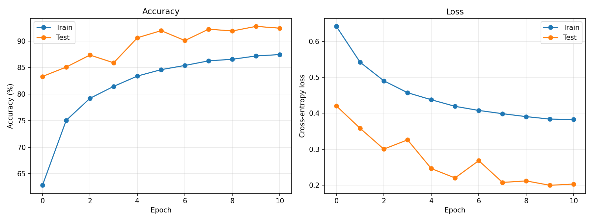
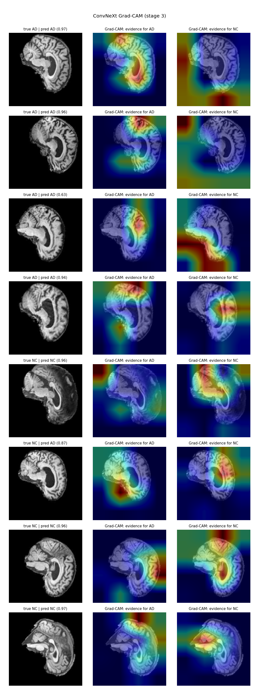

# ConvNeXt for Alzheimer's Disease Classification (ADNI)

## Description of Algorithm

## Problem

## How it Works
1. Run `main.py` from this directory:

   ```bash
   python3 main.py
   ```

   Any of the variables below can be overridden on the command line, e.g.

   ```bash
   python3 main.py --batch_size 32 --epochs 100 --data_path /path/to/AD_NC/train
   ```

   These defaults have been fine-tuned to give the best performing model for classifying MRI scans as AD (Alzheimer's disease) or NC (normal control). Boolean flags take a value, e.g. `--model_ema True`.

### Training

| Argument | Default | Purpose |
|---|---|---|
| `--batch_size` | `64` | Number of images per batch (per GPU). |
| `--epochs` | `150` | Number of passes over the training set. |
| `--update_freq` | `1` | Gradient accumulation steps; the effective batch size is `batch_size × update_freq`. |
| `--start_epoch` | `0` | Epoch to start from (used when resuming training). |
| `--seed` | `0` | Random seed for reproducibility. |
| `--device` | `cuda` | Device to train/evaluate on (`cuda` or `cpu`). |
| `--num_workers` | `4` | Number of DataLoader worker processes for loading images. |
| `--pin_mem` | `True` | Pin CPU memory in the DataLoader for faster transfer to the GPU. |

### Model

| Argument | Default | Purpose |
|---|---|---|
| `--model` | `convnext` | Name of the model architecture to train. |
| `--input_size` | `256` | Height and width (pixels) images are resized to before entering the network. |
| `--drop_path` | `0` | Stochastic depth rate (randomly drops residual blocks during training for regularisation). |
| `--layer_scale_init_value` | `1e-6` | Initial value of ConvNeXt's per-channel layer scale parameters. |
| `--nb_classes` | `2` | Number of output classes (AD and NC). |
| `--head_init_scale` | `1.0` | Scale applied to the classifier head's initial weights; typically adjusted when fine-tuning. |

### Exponential Moving Average (EMA)

| Argument | Default | Purpose |
|---|---|---|
| `--model_ema` | `False` | Keep an exponential moving average of the model weights. |
| `--model_ema_decay` | `0.9999` | Decay rate of the EMA weights. |
| `--model_ema_force_cpu` | `False` | Store the EMA model on the CPU to save GPU memory. |
| `--model_ema_eval` | `False` | Also evaluate the EMA model on the validation set during training. |

### Optimisation

| Argument | Default | Purpose |
|---|---|---|
| `--opt` | `adamw` | Optimiser. |
| `--opt_eps` | `1e-8` | Optimiser epsilon (numerical stability term). |
| `--opt_betas` | `None` | Optimiser betas; `None` uses the optimiser's defaults. |
| `--momentum` | `0.9` | Momentum (only used by the SGD optimiser). |
| `--clip_grad` | `None` | Maximum gradient norm; `None` disables gradient clipping. |
| `--lr` | `4e-3` | Peak learning rate. |
| `--min_lr` | `1e-6` | Lowest learning rate reached by the cosine schedule. |
| `--warmup_epochs` | `20` | Number of epochs the learning rate linearly warms up to `--lr`. |
| `--warmup_steps` | `-1` | Number of warm-up steps; overrides `--warmup_epochs` if greater than 0. |
| `--weight_decay` | `0.05` | Weight decay (L2 regularisation strength). |
| `--weight_decay_end` | `None` | Final weight decay for the cosine weight decay schedule; `None` keeps it constant. |
| `--layer_decay` | `1.0` | Layer-wise learning rate decay; `1.0` gives every layer the same learning rate. |

### Augmentation and Regularisation

| Argument | Default | Purpose |
|---|---|---|
| `--aa` | `''` (off) | AutoAugment/RandAugment policy, e.g. `rand-m9-mstd0.5-inc1`. |
| `--color_jitter` | `0` (off) | Strength of random brightness/contrast/saturation changes. |
| `--train_interpolation` | `bilinear` | Interpolation used when resizing training images (`random`, `bilinear`, `bicubic`). |
| `--smoothing` | `0.1` | Label smoothing applied to the loss. |
| `--reprob` | `0.25` | Probability of applying random erasing to a training image. |
| `--remode` | `pixel` | Random erasing mode (what the erased region is filled with). |
| `--recount` | `1` | Number of regions erased per image. |
| `--crop_pct` | `None` | Centre crop ratio used at evaluation time. |

### Mixup and CutMix

| Argument | Default | Purpose |
|---|---|---|
| `--mixup` | `0.8` | Mixup alpha; mixup is enabled if > 0. |
| `--cutmix` | `1.0` | CutMix alpha; CutMix is enabled if > 0. |
| `--cutmix_minmax` | `None` | CutMix min/max box ratio; overrides `--cutmix` alpha if set. |
| `--mixup_prob` | `1.0` | Probability of applying mixup or CutMix to a batch. |
| `--mixup_switch_prob` | `0.5` | Probability of using CutMix instead of mixup when both are enabled. |
| `--mixup_mode` | `batch` | Granularity of mixup/CutMix parameters: per `batch`, `pair` or `elem`. |

### Data

| Argument | Default | Purpose |
|---|---|---|
| `--data_set` | `ADNI` | Dataset to use (`ADNI` or `CIFAR`). |
| `--data_path` | `/home/isabel/Desktop/data/ADNI/AD_NC/train` | Training images (folder containing `AD/` and `NC/`). |
| `--val_data_path` | `/home/isabel/Desktop/data/ADNI/AD_NC/validation` | Validation images, used for checkpoint selection and tuning. |
| `--eval_data_path` | `/home/isabel/Desktop/data/ADNI/AD_NC/test` | Held-out test images, used for the final reported result. |
| `--stats_dir` | `stats/` (next to `normalise.py`) | Where the training-set mean/std used for normalisation is cached. |

### Checkpoints, Evaluation and Logging

| Argument | Default | Purpose |
|---|---|---|
| `--output_dir` | `/home/isabel/Desktop/results` | Where checkpoints and logs are saved; empty for no saving. |
| `--log_dir` | `/home/isabel/Desktop/log` | Where TensorBoard logs are written. |
| `--finetune` | `''` | Path or URL of a checkpoint to fine-tune from. |
| `--model_key` | `model\|module` | Key(s) to look for in the checkpoint's state dict. |
| `--model_prefix` | `''` | Prefix to strip from checkpoint parameter names when loading. |
| `--eval` | `False` | Only evaluate a trained model (no training). |
| `--disable_eval` | `False` | Skip validation during training. |
| `--dist_eval` | `True` | Use distributed evaluation across multiple GPUs. |
| `--enable_wandb` | `False` | Log to Weights & Biases. |
| `--project` | `convnext` | Weights & Biases project name. |
| `--wandb_ckpt` | `False` | Upload checkpoints to Weights & Biases as artifacts. |

-----------------------------------------------------

## Feasibility Review
### User Need
The intended users of this Alzheimer's detection tool include:
- Doctors and practitioners, to assist in medical diagnosis (as a screening aid).
- Researchers studying Alzheimer's disease, its features, and prediction/detection accuracy.
- Researchers studying machine learning and its application to medical datasets and image processing.

### User Scope
The purpose of this project is to develop a ConvNeXt model as a prototype machine learning computer vision model that classifies 2D T1-weighted brain MRI slices as Alzheimer's Disease (AD) or Cognitively Normal (CN). The model should flag ambiguous or low-confidence classifications for review by a human specialist. Ambiguous cases should be reliably identified, and the predicted confidence should correlate with diagnostic correctness. This is the open research dilemma for Project 2.1: does the model know when it is unsure, or does it stay overconfident when it is wrong?

### Acceptance Criteria
The minimum acceptance criteria are as follows:
- Minimum classification test accuracy of 80% for AD versus CN.
  *Test:* accuracy of the ADNI test split.
- A bias towards false positives over false negatives for misclassifications (missing AD is worse than a false alarm).
  *Test:* AD recall ≥ CN recall, from the confusion matrix (records TP, TN, FP, FN for test data), along with per-class precision, recall and macro-F1 (accuracy for each class).
- Can identify ambiguous vs confident classifications, where confidence correlates with diagnostic correctness.
  *Test:* reliability diagram (test predictions sorted via confidence bins for each classification and plot the actual accuracy for the corrosponding confidence level). A reject threshold that routes <= 20% of boundary cases to a human.
- Can extract discriminative anatomical biomarkers in the latent space despite variation in head shape and age between patients.
  *Test:* Grad-CAM maps focus on brain anatomy rather than the background or image border.
- Benchmark against the original "A ConvNet for the 2020s" paper [1], and against a simple baseline CNN on the same splits.

### Model Choice

Model: ConvNeXt [1]. Difficulty Band: Hard.

The model architecture and pipeline will be as follows. Where possible I use the same macro/micro design and hyperparameters as the paper [1], and I note where they have to change for this dataset and hardware.

1. Data preparation
- Data collection: supplied ADNI AD_NC dataset (`/home/groups/comp3710/ADNI`). The images are 2D greyscale JPEG slices of 256x240 px, with 20 slices per patient. Filenames follow `<patientID>_<sliceID>.jpeg`.
- Data split: Training/validation/testing. 
- Data balancing: the classes are close to balanced (about 48% AD in every split). 
- Data shuffling: training data is shuffled each epoch. Validation and test sets are not shuffled.
- Data labelling: labels come from the folder names (`AD` = 0, `NC` = 1).

2. Data Preprocessing
- Normalisation: Calculation the mean and standaard divation of the data set and normalise the values
- Regularisation (paper settings): weight decay 0.05, Stochastic Depth (drop path 0.1 for ConvNeXt-T), Label Smoothing 0.1, Layer Scale 1e-6.
- Batching: the paper uses a batch size of 4096, which does not fit on one GPU. I will use 32-128 with gradient accumulation and scale the learning rate linearly with batch size.
- Augmentation (paper settings): RandAugment (9, 0.5), Mixup 0.8, CutMix 1.0, Random Erasing 0.25. Mixup/CutMix blend two brains together and may hide anatomy, so I will test the model with and without them.

3. Network Architecture: ConvNeXt
- Macro design: stage compute ratio (3, 3, 9, 3) with channels (96, 192, 384, 768), about 28M parameters. A "patchify" stem (4x4 conv, stride 4) and separate 2x2 stride-2 downsampling layers between stages.
- Micro design: each block is a 7x7 depthwise conv -> LayerNorm -> 1x1 conv (expand x4, the inverted bottleneck) -> GELU -> 1x1 conv (project back), with Layer Scale and a residual connection.
- Activation Function: GELU, with only one activation per block.
- Normalisation: one LayerNorm per block instead of BatchNorm.
- Feature Extraction Method: hierarchical convolutional feature maps over 4 stages. Early stages detect edges and tissue boundaries, while later stages detect structures such as the ventricles and cortical atrophy. Global average pooling -> LayerNorm -> linear head with 2 outputs (AD, CN).

4. Training Procedure
- Optimiser: AdamW (uses momentum and adaptive learning rates to help find the minimum, with decoupled weight decay), weight decay 0.05.
- Learning Rate: paper base LR of 4e-3.
- Epochs: the paper uses 300. I will tune this on validation (expected 50-100).
- Cost/Loss Function: cross-entropy with label smoothing over 2 classes (binary classification: AD vs CN). The softmax output is used as the confidence score.

5. Evaluation Procedure:
- Training and validation: loss and accuracy plots, including "Training vs Validation Loss" (loss against epochs) and "Training vs Validation Accuracy" (accuracy against epochs). These plots help detect overfitting or underfitting.
- Performance Metrics: accuracy, per-class precision, recall, macro-F1, and the confusion matrix. For the open question: a reliability diagram, and accuracy against rejection-rate curves to choose a confidence threshold.
- Visualisation of Predictions: use activation maps (Grad-CAM) to determine how the model chose between the image classes.

6. Testing Procedure:
- Generalisability:
  - Evaluate against the test set (once, after model and threshold selection on validation).
  - Compare with a simple baseline CNN on the same test split.
- Compactness:
  - Determine the number of parameters, the memory footprint (peak GPU VRAM) and the storage size of the checkpoint.
- Inference Time:
  - Measure how long the model takes to process one input (or a batch of inputs) and output a prediction after training, and compare these results with the original benchmark paper (ConvNeXt-T: 774.7 img/s on a V100 at 224² [1]).

Dataset: ADNI dataset

The ADNI dataset provides structural MRI scans that can be preprocessed to include only the Alzheimer's disease and Cognitively Normal classes, accessible via the ADNI portal [3]. The full ADNI cohort has 591 subjects with Alzheimer's disease and 1479 cognitively normal subjects, with approximately a 50/50 split in sex and a varied age split.

The course subset used in this project contains 1,526 patients (743 AD, 783 CN). The data will be split into 3 sets, with each patient's data confined to a single split to avoid data leakage:

| Split | AD slices | NC slices | AD patients | NC patients |
|-------|----------:|----------:|------------:|------------:|
| Train | 8,840 | 9,460 | 442 | 473 |
| Validate (15% of the original train set, by patient) | 1,560 | 1,660 | 78 | 83 |
| Test | 4,460 | 4,540 | 223 | 227 |

### Course Concepts
Key course concepts that will help in building this model include:
- Convolutional Neural Networks (a class of deep learning models suited to image processing):
    - Inductive Biases: assumptions built into an algorithm, such as translational equivariance and local connectivity (connecting the pixels in a small region to a neuron), which come from convolution and help with image recognition. *Why it matters here:* patterns (an enlarged ventricle, a shrunken hippocampus) are local shapes that can appear at slightly different positions between patients. With only ~1,500 patients, a CNN needs less data than a Vision Transformer.
    - Kernel: a learned filter that starts from initial values and is then updated according to gradients to reduce classification loss/error.
    - Feature Map: the result of convolving a kernel with the input. It is a filtered version of the input that highlights the feature detected by the filter.
    - Padding: adds extra pixels to stop convolution from shrinking the feature map and to allow features to be detected at the edges of the input.
    - Stride: downsamples the input and captures more global features by skipping positions (the kernel moves more than one pixel at a time). ConvNeXt's patchify stem is a 4×4 conv with stride 4.
    - Layers: apply all the kernels to the input to get a set of feature maps, then apply new kernels to those feature maps, and so on. Each new set of feature maps is a new layer. Early layers capture fine-grained details like edges, middle layers detect textures and shapes, and deeper layers extract abstract features.
    - Pooling Layers: downsample the feature map by reducing spatial dimensions, using either average pooling (the average value in a region) or max pooling (the maximum value in a region). This reduces noise and improves memory efficiency. ConvNeXt uses global average pooling before the classifier head.
- Training:
    - Dropout: randomly disable neurons during training, forcing neurons to learn independently. This reduces overfitting and improves generalisability. ConvNeXt uses Stochastic Depth, a related method that randomly drops whole residual blocks.
    - Layer Normalisation: normalises across all channels at each spatial position in a layer, shifting the data back to a normalised distribution to improve convergence. ConvNeXt uses LayerNorm instead of BatchNorm.
- Classifiers: design a decision boundary between features that separates the classes (here, a linear head on pooled ConvNeXt features separates AD from CN).
- Neurons in Machine Learning:
    - Multi-Layer Perceptron (MLP): a network of fully connected neurons in hidden layers that takes an input and classifies it as an output. The 1×1 convs in a ConvNeXt block act as a per-pixel MLP.
    - Neuron: a node in a layer with multiple inputs, which it multiplies by a set of learned weights and sums. The sum is passed through an activation function (e.g. ReLU, GELU) that determines the neuron's output.
- Optimisation (a method for updating the weights in the network so the neurons become more accurate in their classifications):
    - Gradient Descent: calculate the derivative (gradient) of the cost function with respect to the weights, and step the weights in the opposite direction to move towards a minimum of the loss.
    - Backpropagation: send the error back through the layers using the chain rule, and update each neuron's weights to give better classifications.

How course concepts and literature support the choices:
- The paper [1] shows that a pure ConvNet with these modernised design choices matches or beats the Swin Transformer on ImageNet at similar compute (ConvNeXt-T 82.1% vs Swin-T 81.3%). It keeps the convolution inductive biases above, which matter more on a small medical dataset than on ImageNet.
- Prior ConvNeXt work on Alzheimer's MRI suggests the 80% target is achievable:
  - ConvNeXt-Base reaches 98.37% accuracy (AUC 0.992) on coronal slices, against about 92% on axial and sagittal slices [5], [8]. However, this was on a different, small and imbalanced dataset (AlzaSet: 79 subjects, 63 AD and 16 NC) [9].

### Preliminary Feasibility Evidence
Smoke test: I tested the baseline code from the paper's official repository [2], starting from ImageNet-1K pre-trained initial weights and fine-tuning on my ADNI dataset on a CPU. This checks that the data pipeline and training loop work end to end. The only code changes were adding an `ADNI` dataset option.

```bash
nohup python -u main.py \
  --model convnext_tiny --data_set ADNI \
  --data_path "data/ADNI/AD_NC/train" \
  --eval_data_path "data/ADNI/AD_NC/validation" \
  --finetune https://dl.fbaipublicfiles.com/convnext/convnext_tiny_1k_224_ema.pth \
  --epochs 11 --warmup_epochs 1 \
  --lr 1e-4 --min_lr 1e-6 \
  --batch_size 16 --update_freq 4 \
  --input_size 128 \
  --drop_path 0.1 --mixup 0 --cutmix 0 \
  --num_workers 4 --device cpu \
  --output_dir ./out_adni_cpu --log_dir ./out_adni_cpu \
  --auto_resume true \
  > train_cpu.log 2>&1 &
```

Monitoring it:
- `tail -f train_cpu.log` shows progress.

Test:
```bash
python main.py --model convnext_tiny --data_set ADNI --input_size 128 --device cpu \
  --eval true --resume out_adni_cpu/checkpoint-best.pth \
  --eval_data_path "data/ADNI/AD_NC/test"
```

Results:

| Measurement | Value |
|---|---|
| Parameters | 27.8 M |
| Training time (11 epochs, CPU) | 4 h 52 min |
| Best validation accuracy | 92.8% (epoch 9) |
| Test accuracy (9,000 slices) | **75.6%** (loss 0.628) |
| Test AD recall / CN recall (estimated*) | 57% / 94% |
| CPU inference | 3.7 s per batch of 96 at 128² ( 39 ms per slice) |

<details>
<summary>Raw test log</summary>

```
Test:  [ 0/94]  eta: 0:04:23  loss: 2.4426 (2.4426)  acc1: 4.1667 (4.1667)  acc5: 100.0000 (100.0000)  time: 2.8071  data: 0.5117
Test:  [10/94]  eta: 0:03:50  loss: 1.9510 (1.8226)  acc1: 26.0417 (25.9470)  acc5: 100.0000 (100.0000)  time: 2.7448  data: 0.0480
Test:  [20/94]  eta: 0:03:20  loss: 1.8853 (1.9073)  acc1: 20.8333 (23.8095)  acc5: 100.0000 (100.0000)  time: 2.7022  data: 0.0013
Test:  [30/94]  eta: 0:02:52  loss: 1.4274 (1.4033)  acc1: 33.3333 (44.3884)  acc5: 100.0000 (100.0000)  time: 2.6726  data: 0.0023
Test:  [40/94]  eta: 0:02:25  loss: 0.1186 (1.0981)  acc1: 96.8750 (56.6057)  acc5: 100.0000 (100.0000)  time: 2.6954  data: 0.0036
Test:  [50/94]  eta: 0:01:58  loss: 0.0801 (0.9719)  acc1: 97.9167 (61.8056)  acc5: 100.0000 (100.0000)  time: 2.6797  data: 0.0031
Test:  [60/94]  eta: 0:01:31  loss: 0.1118 (0.8549)  acc1: 91.6667 (66.4447)  acc5: 100.0000 (100.0000)  time: 2.6258  data: 0.0023
Test:  [70/94]  eta: 0:01:04  loss: 0.1881 (0.7621)  acc1: 91.6667 (70.2758)  acc5: 100.0000 (100.0000)  time: 2.6950  data: 0.0022
Test:  [80/94]  eta: 0:00:40  loss: 0.1339 (0.6869)  acc1: 95.8333 (73.3282)  acc5: 100.0000 (100.0000)  time: 3.4167  data: 0.0033
Test:  [90/94]  eta: 0:00:14  loss: 0.1407 (0.6414)  acc1: 95.8333 (75.0801)  acc5: 100.0000 (100.0000)  time: 6.9576  data: 0.0063
Test:  [93/94]  eta: 0:00:03  loss: 0.1424 (0.6276)  acc1: 94.7917 (75.5667)  acc5: 100.0000 (100.0000)  time: 7.4037  data: 0.0063
Test: Total time: 0:05:47 (3.7014 s / it)
Acc@1 75.567 Acc@5 100.000 loss 0.628
Accuracy of the network on 9000 test images: 75.56667%
```
</details>



*Smoke-test training curves. The orange "Test" line is the validation split.*



*Grad-CAM (stage 3) on test slices: evidence for AD and for NC.*

What this shows:
1. The pipeline works end to end and the model is learning: validation loss falls from 0.42 to 0.20 over 11 epochs.
2. Test accuracy (75.6%) is **below the 80% target**. Most errors are AD scans predicted as CN (false negatives), which is the opposite to the desired outcome.
4. Grad-CAM often highlights the ventricles and medial temporal region (plausible AD biomarkers). Some maps also highlight the image border or background, which suggests shortcut learning.

### Risks
The key risks are:
- The model may take a long time to train, leaving too little time to fine-tune the parameters to meet the minimum accuracy requirement. The paper trains for 300 epochs, and the CPU smoke test took ~5 h for 11 epochs at 128². *Mitigation:* train on GPU, start from ImageNet weights as tests, and run short test before long runs.
- The smoke test is below 80% on test and is biased towards false negatives. *Mitigation:* train at 224² for longer, aggregate the 20 slices of each patient into one patient-level prediction and set the decision threshold to favour AD recall.
- The validation set may not represent the test set. *Mitigation:* investigate the split.
- I have not yet tested running a Swin Transformer, so I may not be able to benchmark against the Swin Transformer myself. *Mitigation:* use the paper's published Swin-T numbers for comparison. The task sheet only requires a simple baseline CNN, which is lower risk.

### Computing Budget
There are three compute options:
- RTX 3080 (24/7 access)
- RTX2040 (lab computers, limited access)
- Rangpur A100 (dependent on demand and queue times)

The "A ConvNet for the 2020s" foundation paper measured inference throughput on V100 GPUs and training memory with a per-GPU batch size of 32. ConvNeXt-T runs at 1943.5 img/s vs 1325.6 img/s for Swin-T (+47%), and up to +49% for larger models.

Therefore, the RTX 3080 will be used for development and testing, as it is easy to access. Initial benchmark tests (ConvNeXt vs baseline: VRAM, training time, inference latency) will also be run on the RTX 3080 so the numbers are comparable.

### Next Planned Experiment
The next planned experiment is to modify the original paper's ConvNeXt to process ADNI MRI scans, combining techniques from:
- Basereh et al., ConvNeXt-driven detection of AD across anatomical planes (*Diagnostics*, 2025) [5]
- Vyas, NeuroScan / adni_code (GitHub) [6]
- Jin et al., CA-ConvNeXt (Intelligence Science IV, 2022) [7]
- Basereh et al., bioRxiv preprint of [5] [8]

I will write my own ConvNeXt in `modules.py` (following the paper's architecture) along with `dataset.py`, `train.py` and `predict.py`. I will then run this model without pre-training on the RTX 3080, and compare it with the ImageNet-pretrained version from the smoke test. Hyperparameters and parameters will be fine-tuned from there to reach the required minimum test accuracy of 0.8.

If time allows I would like to test how the data affects the model by using the AlzaSet dataset [9] (the dataset behind [5]) to check whether including coronal, sagittal and axial MRI slices improves model accuracy. This would indicate which angle of brain slice is most informative for Alzheimer's detection.

### Fallback
If the ConvNeXt project takes too long to train, or fails to produce viable results, I will revert to project 2.2 "Segmentation: Anatomical Contouring and Radiotherapy Planning" with U-Net (2D U-Net / Improved U-Net on OASIS is Easy difficulty, capped at 10/20 for implementation).

The U-Net architecture is also based on convolution, the same as ConvNeXt. It contains an encoder, a bottleneck and a decoder, forming a U-shaped structure. 

This project similarly looks at brain tissue slices. However, it focuses on delineating cortical grey matter, white matter and cerebrospinal fluid across 2D slices, whereas ConvNeXt aims to classify the entire image as either Cognitively Normal or Alzheimer's.

The similar convolution concepts and datasets make this a viable fallback, especially as a similar project was completed in Demo 2.

-----------------------------------------

## Dependencies 

## Reproducibility

## Examples

### Inputs

### Outputs

### Visualisations

# Open Research Dilemma

## Quantitative Benchmarking

## Computational Efficiency

## Qualitative Error

## Engineering Recommendations

## Artificial Intelligence Usage Disclosure

## References

[1] Z. Liu, H. Mao, C.-Y. Wu, C. Feichtenhofer, T. Darrell, and S. Xie, "A ConvNet for the 2020s," in *Proc. IEEE/CVF Conf. Computer Vision and Pattern Recognition (CVPR)*, 2022, pp. 11976–11986. [Online]. Available: https://arxiv.org/abs/2201.03545

[2] Meta AI Research, "ConvNeXt: official PyTorch implementation," GitHub repository. [Online]. Available: https://github.com/facebookresearch/ConvNeXt

[3] Alzheimer's Disease Neuroimaging Initiative (ADNI). [Online]. Available: http://adni.loni.usc.edu

[4] G. H. Huynh, "Alzheimers-MRI-ConvNext: PyTorch implementation of ConvNeXt for Alzheimer's MRI classification," GitHub repository. [Online]. Available: https://github.com/hunghuynh1110/Alzheimers-MRI-ConvNext

[5] M. Basereh, M. A. Abikenari, S. Sadeghzadeh, T. Dunn, R. Freichel, P. Siddarth, D. Ghahremani, H. Lavretsky, and V. P. Buch, "ConvNeXt-driven detection of Alzheimer's disease: A benchmark study on expert-annotated AlzaSet MRI dataset across anatomical planes," *Diagnostics*, vol. 15, no. 23, Art. no. 2997, 2025, doi: 10.3390/diagnostics15232997. [Online]. Available: https://pmc.ncbi.nlm.nih.gov/articles/PMC12691013/

[6] M. R. Vyas, "NeuroScan (adni_code)," GitHub repository. [Online]. Available: https://github.com/MeetRVyas/adni_code

[7] W. Jin, Y. Yin, J. Bai, and H. Zhen, "CA-ConvNeXt: Coordinate attention on ConvNeXt for early Alzheimer's disease classification," in *Intelligence Science IV*, IFIP Advances in Information and Communication Technology. Cham, Switzerland: Springer, 2022, pp. 450–457, doi: 10.1007/978-3-031-14903-0_48. [Online]. Available: https://link.springer.com/chapter/10.1007/978-3-031-14903-0_48

[8] M. Basereh *et al.*, "ConvNeXt-driven detection of Alzheimer's disease: A benchmark study on expert-annotated AlzaSet MRI dataset across anatomical planes," bioRxiv preprint, Jul. 2025, doi: 10.1101/2025.07.10.664260. [Online]. Available: https://www.biorxiv.org/content/10.1101/2025.07.10.664260v1.full

[9] M. Basereh, "AlzaSet: MRI dataset for 'ConvNeXt-driven Alzheimer's detection: A benchmark study on expert-annotated AlzaSet MRI dataset across anatomical planes'," Zenodo, version v2, 2025, doi: 10.5281/zenodo.17084199. [Online]. Available: https://zenodo.org/records/17084199
