# ConvNeXt for Alzheimer's Disease Classification on ADNI Brain MRI

**COMP3710 Project 2.1 (Classification) - ConvNeXt - Hard difficulty** by Isabel Barton

Summary: A PyTorch ConvNeXt that classifies T1-weighted structural brain MRI slices from the ADNI dataset as **Alzheimer's disease (AD)** or **cognitively normal (NC)**. The final classification combines each scan's 20 MRI slices into one classification, and studies the question: *does the ConvNeXt model know when it is unsure, or is it overconfident?*

The final ConvNeXt-Tiny model reaches **80.5% patient-level test accuracy**, with AD recall above NC recall, calibrated confidence and a referral rule that sends ~17% of scans to a specialist to verify (scan classifications that the model is not confident in). A plain baseline CNN with 70x fewer parameters performs as well on the same split, reaching 82.7% test accuracy without any dataset or parameter fine-tuning.

Therefore, the main engineering recommendation is that ConvNeXt's extra cost is not justified for this data.

---

## 1. Problem and Algorithm

### 1.1 The problem

Alzheimer's disease causes irreversible neurodegeneration that shows on structural MRIs as hippocampal and cortical atrophy and enlarged ventricles. An automated classifier that labels T1-weighted scans as AD or NC could support screening, but only if it is accurate on new patients (e.g. a test set) and if its confidence can be trusted (i.e. a confident missed AD case is far worse than a false alarm). The difficulties are natural variation in head shape and age between people, and the subtle differences between early AD and normal ageing.

The task is binary classification of 2D sagittal slices (256 × 240 greyscale, 20 consecutive slices per scan) from an ADNI data subset [3], with a target of **≥ 0.80 test accuracy**.

### 1.2 The algorithm: ConvNeXt

ConvNeXt [1] is a pure convolutional network that was modified from a ResNet to mimic properties of vision Transformers. Vision Transformers are often seen as the modern state of the art in computer vision. However, ConvNeXt-T matched Swin-T on the ImageNet dataset (82.1% vs 81.3%) at similar compute [1]. ConvNeXt mimics vision Transformers in the following ways:

- **Stage compute ratio:** blocks per stage changed from ResNet's (3, 4, 6, 3) to (3, 3, 9, 3), matching Swin's 1:1:3:1 ratio.
- **Patchify stem:** a 4x4, stride-4 non-overlapping convolution replaces ResNet's 7x7 conv and max-pool, like the patch embedding of ViT/Swin.
- **Inverted bottleneck:** each block expands to 4x the channels and projects back (C -> 4C -> C), like the Transformer MLP block.
- **Large kernels:** the depthwise convolution is moved to the start of the block (as self-attention comes before the MLP) and enlarged to 7x7, matching Swin's 7x7 attention windows.
- **Fewer activations and normalisations:** GELU replaces ReLU, with only one activation and one normalisation per block, as in a Transformer block.

My ConvNeXt is based on the model in [1], and the code was cloned from the official implementation [2] and then modified. The model as developed in `modules.py` is depicted in Figure 1 below.

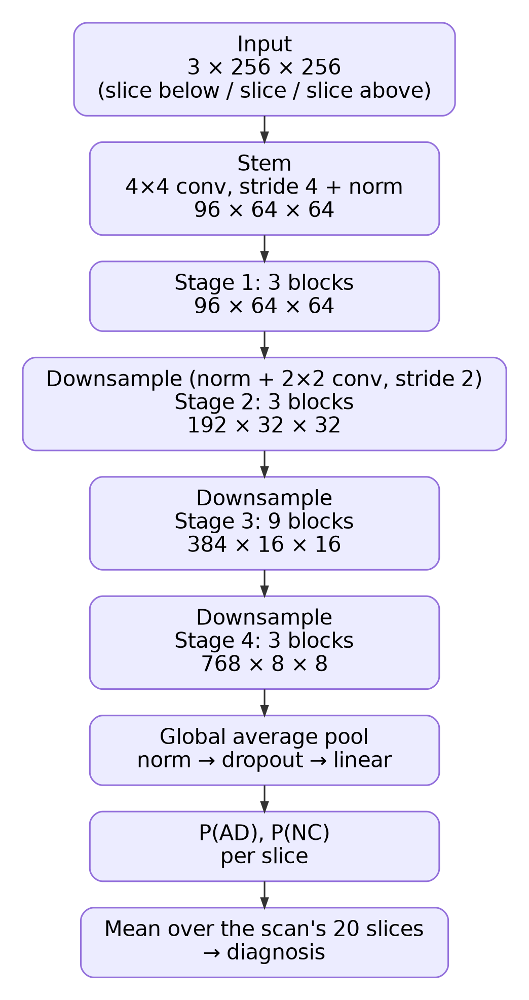

*Figure 1. ConvNeXt-T as used here (`modules.py`). Each block (below) keeps the shape; downsampling layers halve the resolution and double the channels.*

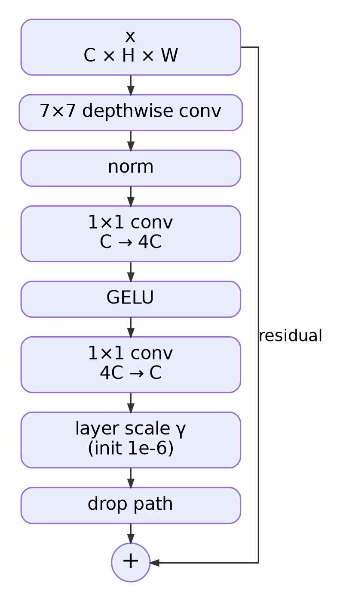

*Figure 2. A ConvNeXt block: a large-kernel depthwise convolution mixes space, an inverted-bottleneck (1×1 convs, expansion ×4, one GELU) mixes channels, and the residual branch is scaled by a learnable per-channel value and randomly dropped during training.*

**How it works.** Each MRI slice is padded from 256 x 240 to 256 x 256, and instead of RGB, the three input channels are the slice and its two neighbouring slices. The **patchify stem** turns non-overlapping 4 x 4 pixel patches into 96-channel features. Four **stages** of ConvNeXt blocks (3, 3, 9, 3 blocks) build a feature hierarchy, from edges and boundaries in stage 1 to more complex structures in stages 3-4, while strided 2 x 2 convolutions halve the resolution between stages (64 -> 32 -> 16 -> 8). Global average pooling gives one 768-dimensional vector per slice, and a linear head outputs the logits for AD and NC. Softmax then converts these logits into a probability for each slice. A scan's diagnosis is the mean P(AD) over its 20 slices, optionally scaled and compared with a threshold, and scans whose probability lies close to the threshold are referred to a specialist.

**Changes from the paper and original git repo**:

| Component | ConvNeXt paper [1] | This project | Why |
|---|---|---|---|
| Normalisation | LayerNorm | **BatchNorm** [15] (`convnext_tiny_bn`); LayerNorm kept as `convnext_tiny` | BatchNorm trained from scratch faster and more accurately (Section 5.1). The paper [1] also only reported a +0.1% gain from LayerNorm on ImageNet |
| Classifier head | LayerNorm -> linear | BatchNorm1d -> **dropout 0.4** -> linear | Extra regularisation against early overfitting |
| Input | RGB image | slices n−1, n, n+1 as the 3 channels (`dataset.NeighbourSliceFolder`) | Atrophy is a 3D change; the paper's 3 channels would otherwise hold 3 copies of one slice. This change resulted in +3.9 accuracy points (Section 5.1) |
| Initialisation | Pretrained ImageNet training, 300 epochs | 18 epochs | The smaller dataset saw no benifit past 18 epochs and risked overfitting |
| Augmentation | RandAugment, Mixup, CutMix, flips | small rotations, intensity jitter, random erasing | keep the anatomy and label of each slice intact (Section 3.4) |

The implementation follows the official ConvNeXt code [2] (blocks, drop path, layer scale, AdamW parameter groups, schedules), adapted for ADNI with reference to other ADNI ConvNeXt code [4], [6]; Sources are also cited in the code.

The **baseline** (`simple_cnn`) is a plain CNN with four blocks of 3 × 3 conv -> BatchNorm -> ReLU -> 2 × 2 max-pool (32–256 channels), global average pooling, dropout 0.4 and a linear head, totalling 0.39 M parameters.

---

## Feasibility Review

*Project 2.1 · ConvNeXt on ADNI (AD vs CN) · Hard difficulty*

### 1. User Need, Scope & Acceptance Criteria
**Users:** clinicians (screening aid) and Alzheimer's / medical-imaging ML researchers. **Purpose:** classify 2D T1-weighted brain MRI slices as AD or CN and route low-confidence cases to a specialist. **Open dilemma:** does the model know when it is unsure, or stay overconfident when wrong, compared with a baseline CNN?

| # | Acceptance criterion | Test |
|---|---|---|
| 1 | Test accuracy ≥ 0.80 | ADNI test split, evaluated once after selection on validation |
| 2 | Missing AD is worse than a false alarm | AD recall ≥ CN recall (confusion matrix); also precision, macro-F1, AUROC |
| 3 | Confidence tracks correctness better than the baseline | Reliability diagram and ECE vs baseline CNN; a reject rule routing ≤ 20% of cases to a human raises accuracy on the rest |
| 4 | Uses anatomy, not shortcuts | Grad-CAM focuses on the brain, not the background or border |
| 5 | Resource: fits one RTX 3080 (10 GB) | Peak training VRAM < 10 GB; one run < 12 h; latency and parameters vs baseline |

### 2. Model Choice & Course Concepts
- **Data:** course ADNI subset, 1,526 patients x 20 sagittal 256×240 slices, ~48% AD. Split by patient: train 915, validation 161 (15%), test 450 (used once). Greyscale -> 3 channels, padded to 256², training-set mean/std normalisation.
- **Architecture:** ConvNeXt-T [1] (blocks 3-3-9-3, channels 96–768, 27.8 M parameters): 4×4 patchify stem; blocks of 7x7 depthwise conv -> LayerNorm -> 1x1 conv x4 -> GELU -> 1x1 conv, with layer scale, drop path and residual; pooled -> 2-way linear head, softmax = confidence. Paper training settings where possible (AdamW, wd 0.05, warmup + cosine LR, label smoothing 0.1), batch 4096 -> 64 with LR scaled.
- **Course concepts:** convolution's inductive biases (locality, translation equivariance) fit atrophy, which appears as local shapes at shifting positions, and need less data than a ViT for ~1,500 patients. Strided downsampling builds hierarchical features (edges -> ventricles, cortex); stochastic depth, weight decay and normalisation limit overfitting.
- **Literature:** ConvNeXt-T beats Swin-T on ImageNet (82.1% vs 81.3%) as a pure CNN [1], so 0.80 is plausible. Mixup/CutMix blend two brains, so they will be tested on and off.

### 3. Preliminary Feasibility Evidence
**Data audit:** 20 slices per patient, all 256x240, no patient in more than one split. **Smoke test:** official ConvNeXt code [2] with an ADNI loader, ImageNet-pretrained ConvNeXt-T fine-tuned on CPU (128², 11 epochs, batch 64, LR 1e-4).

| Measurement | Result | Measurement | Result |
|---|---|---|---|
| Training time (CPU) | 4 h 52 min | Test accuracy (9,000 slices) | **75.6%** |
| Best validation accuracy | 92.8% (epoch 9) | AD / CN recall (estimated) | 57% / 94% |
| Parameters | 27.8 M | CPU inference (128²) | 39 ms per slice |

The pipeline works end to end (validation loss 0.42 -> 0.20). Test accuracy is below target with a large validation–test gap, and most errors are missed AD (failing acceptance criterion 2). Grad-CAM often highlights the ventricles and medial temporal lobe, but sometimes the border (possible shortcut).

### 4. Risks, Budget & Fallback
- **Risks -> mitigations:** 
*long training* (CPU ~5 h for 11 epochs) -> GPU with mixed precision, short runs first, epochs tuned on validation (50–100). 
*Below 0.80, biased against AD* -> 256² input, patient-level averaging of 20 slices, validation-chosen threshold favouring AD recall. 
*Validation unlike test* -> audit the split, select on validation only. 
*No Swin-T run* -> cite the paper and complete the baseline CNN as the required comparison.
- **Budget:** RTX 3080 (10 GB, 24/7) for all development and benchmarks so numbers are comparable; lab GPUs and Rangpur A100 as backup.
- **Next experiment:** my own ConvNeXt-T trained from scratch on the RTX 3080, compared with the pretrained smoke test and tuned towards 0.80 test accuracy; then the baseline CNN and calibration analysis.
- **Fallback:** Project 2.2, 2D U-Net brain segmentation on OASIS (Easy, capped at 10/20): same convolution concepts and brain MRI, and similar to Demo 2.

---

## 3. Data, Pre-processing and Splits

### 3.1 Dataset

The course's ADNI subset [3] contains 30,520 JPEG slices: **1,526 scans** (743 AD, 783 NC) with 20 consecutive sagittal slices each, 256 × 240 greyscale. Files are named `<id>_<slice>.jpeg`. 

### 3.2 Patient leakage across ADNI visits

**The problem.** The `<id>` in each filename is the ADNI **image ID of one scan session**, not the person. `meta_data_with_label.json` (supplied with the dataset) contains each original ADNI file name which gives the subject ID, sequence and acquisition date:

```
ADNI_068_S_0473_MR_Accelerated_Sagittal_MPRAGE__br_raw_20171116173455030_..._I932015.nii
     └ subject       └ sequence                         └ 2017-11-16          └ image ID (= filename ID)
```

The 1,525 scans come from only **680 people** (221 AD, 459 NC), many scanned at several visits. The course's train/test split and any split by filename ID therefore put the same people in more than one split: **216 people** are in both the course training folder and test, and 95% of the AD scans in a filename-ID validation split (74 of 78) belonged to people also in training.

On NC, people seen in training scored 0.99 and new people 0.88. The model was largely recognising **people** rather than AD.

### 3.3 Leakage-free subject-level split

`subject_datasplit.py` re-splits all 1,525 scans **by ADNI subject**, so no person appears in more than one split. The final train/validation/test split (60/10/30%) was:

| Split | Class | Scans | Slices |
|---|---|---|---|
| train | AD | 443 | 8,860 | 
| train | NC | 470 | 9,400 |
| validation | AD | 72 | 1,440 |
| validation | NC | 78 | 1,560 | 
| test | AD | 227 | 4,540 | 68 | 
| test | NC | 235 | 4,700 | 142 | 

**What it changed** (LayerNorm ConvNeXt-T with identical settings on different dataset splits):

| | Initial Course split | New Patient split |
|---|---|---|
| Best validation slice accuracy | 84.8% | 75.7% |
| Test slice accuracy | 68.2% | 69.6% |
| **Validation - test gap** | **16.6 points** | **6.1 points** |
| Test patient AD / NC recall | **0.42 / 0.96** | **0.75 / 0.69** |

Removing the leak made validation more accurate. The gap between test and validation shrank from 17 to 6 points, and the strong NC bias was removed. All results below use this split.

### 3.4 Pre-processing and augmentation

All transforms are in `normalise.py`; the dataset classes are in `dataset.py`.

| Step | Train | Validation / test | Reason |
|---|---|---|---|
| Pad to square (`PadToSquare`) | Y | Y | 256 × 240 -> 256 × 256 with black rows; this way the brain is never stretched |
| 3 channels | Y | Y | neighbouring slices n−1, n, n+1 of the same scan as R, G, B; edge slices repeat themselves; no data crosses splits |
| Random alterations | ±15°, shift ±8%, zoom ±10% | N | head tilt, position and size differences between people (age, gender) and scanners |
| Brightness / contrast | ±30% | N | scanner and acquisition intensity differences |
| Normalise | Y | Y | mean 0.1085, std 0.2197 computed on the **training split only** and cached in `stats/` |
| Random erasing [20] | p = 0.25, one noise-filled rectangle | N | Robustness, as in ConvNeXt [1] |

**Deliberately not used:** Horizontal flips (all sagittal slices face the same way; a mirrored brain never appears at test), and **Mixup/CutMix** [1], which blend or paste two brains so the label no longer matches the anatomy, which is what the features should be detecting / learning.

---

## 4. Training

`main.py` trains with `train.py` (training, validation, testing and checkpointing), validating every epoch and testing the best validation checkpoint once at the end (see Section 7.2 for the commands).

| Setting | Final value | Reason |
|---|---|---|
| Optimiser | AdamW [18] with weight decay 0.05 | ConvNeXt's optimiser and decay [1]. Weight decay shrinks weights towards 0 each step to reduce overfitting. |
| Learning rate | 5e-4 peak, 3-epoch linear warmup, cosine decay to 1e-6 |Warmup avoids large, unreliable updates from the random initial weights; the cosine decay then shrinks the steps so the weights settle into a minimum instead of bouncing around it |
| Epochs | **18** | validation loss reaches its minimum around epoch 10 in every run and then rises (Figure 4), so runs are kept short |
| Batch size | 64 (285 steps/epoch) | fits the RTX 3080 |
| Loss | cross-entropy, label smoothing 0.1 [10] | the paper's setting [1] - it discourages over-confident predictions |
| Regularisation | drop path 0.3, head dropout 0.4, augmentation (3.4) | A 28 M-parameter model overfits small datasets quickly, so this reduces overfitting |
| Checkpoint selection | best patient-level validation macro-F1 | slice accuracy hides the AD/NC split of errors and fluctuates on a small validation sets therefore patient values are used.|

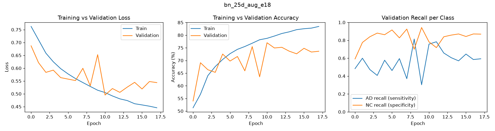

*Figure 4. Final model: validation loss is lowest at epoch 10 (0.495) and rises slightly afterwards (0.544) while training loss keeps falling (0.446): the beginning of overfitting, which is why runs are short.*

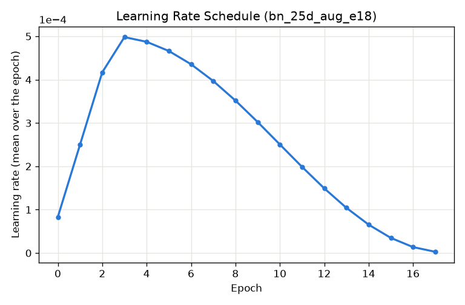

*Figure 5. Learning rate per epoch (mean over each epoch's 285 steps): 3 warmup epochs, then cosine decay.* 

---

## 5. Results

*Note: "Patient" means one scan (the mean of its 20 slices).

### 5.1 Development: What each change contributed

| Run | Model | Changes | Test patient acc. | Patient AUROC | AD / NC recall |
|---|---|---|---|---|---|
| `ln_subjsplit` | ConvNeXt-T, LayerNorm | 30 epochs, single-slice input | 72.1% | 0.814 | 0.75 / 0.69 |
| `bn_subjsplit` | ConvNeXt-T, **BatchNorm** + head dropout | as above | 73.8% | 0.840 | 0.88 / 0.60 |
| `bn_subjsplit_25d` | ConvNeXt-T, BN | extra dimensions via neighbouring channels | 77.7% | 0.870 | 0.90 / 0.66 |
| `bn_25d_aug_e18` | ConvNeXt-T, BN | **+ stronger augmentation, 18 epochs** | **80.5%** | **0.893** | 0.92 / 0.69 |
| `bn_25d_aug_e18_step2` | ConvNeXt-T, BN | neighbours 2 slices apart | 76.6% | 0.877 | 0.91 / 0.63 |
| `bn_nano_25d_aug_e18` | ConvNeXt-**Nano**, BN | smaller model | 79.2% | 0.887 | 0.89 / 0.70 |

- **Extra dimensions via neighbouring channels** had the largest gain: +3.9 points patient accuracy, at no extra compute cost.
- **BatchNorm vs LayerNorm**: +1.7 points with single-slice input. LayerNorm learned slowly (validation near 50-60% for the first ~5 epochs).
- **Stronger augmentation & 18 epochs**: +2.8 points and halved the training time.
- **Nano vs Tiny**: −1.3 points.

### 5.2 Final model

The final model is **BatchNorm ConvNeXt-T with extra dimensions via neighbouring channels on input, trained for 18 epochs**.

Results of three runs (seeds) of the final model:

| Seed | Slice acc. | Slice AUROC | **Patient acc.** | Patient AUROC | AD / NC recall | Macro-F1 |
|---|---|---|---|---|---|---|
| 0 | 76.1% | 0.842 | 80.5% | 0.893 | 0.92 / 0.69 | 0.803 |
| 1 | 74.1% | 0.827 | 80.5% | 0.871 | 0.82 / 0.79 | 0.805 |
| 2 | 74.6% | 0.825 | 77.3% | 0.875 | 0.78 / 0.76 | 0.773 |
| **Mean** | **74.9%** | **0.831** | **79.4%** (77.3–80.5) | **0.880** | **0.84 / 0.75** | **0.794** |

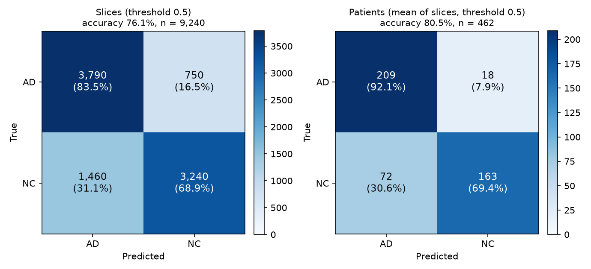

*Figure 6. Seed 0 at threshold 0.5. Averaging the 20 slices of a scan halves the missed AD (16.5% of slices -> 7.9% of scans); false alarms stay at ~31% because CN people the model calls AD have most of their slices called AD.*

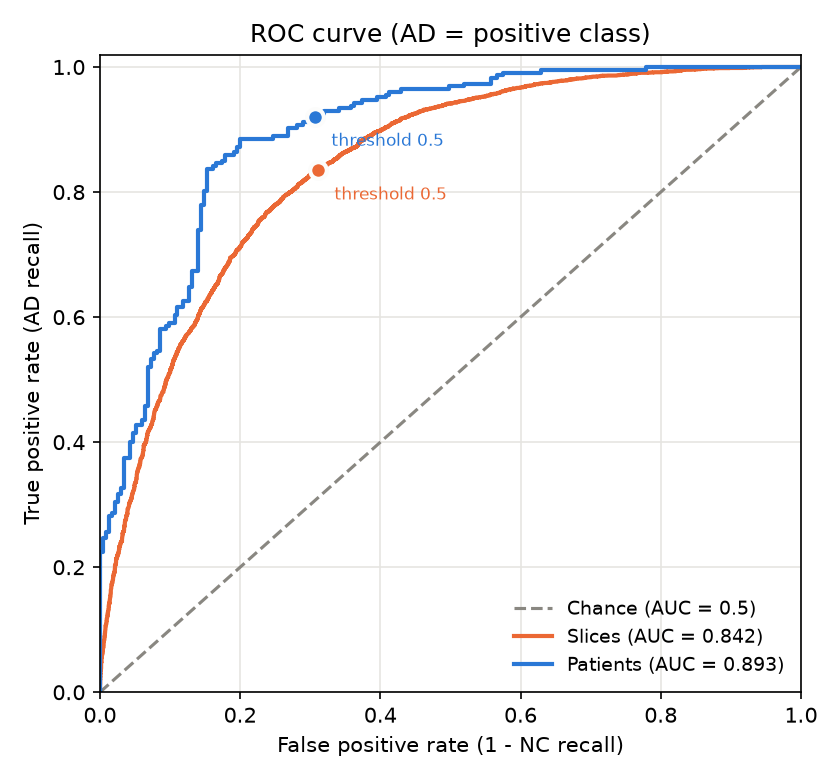

*Figure 7. ROC curves (AD = positive). Scan-level AUROC 0.893 exceeds slice-level 0.842 almost everywhere; the dots mark threshold 0.5.*

**Acceptance criteria from the feasibility review:**

| # | Criterion | Result | Met? |
|---|---|---|---|
| 1 | Test accuracy ≥ 0.80 | 79.4% patient-level (≥ 0.80 in 2 of 3 seeds); slice-level 74.9% | Y |
| 2 | AD recall ≥ NC recall | 0.92/0.69, 0.82/0.79, 0.78/0.76 | Y |
| 3 | Confidence tracks correctness better than the baseline; ≤ 20% referral raises accuracy | referral: 16.7% of scans -> 77.9% to 83.4% | Y |
| 4 | Grad-CAM on anatomy, not shortcuts | heat maps favour the brain | Partly |
| 5 | Fits one RTX 3080: VRAM < 10 GB, run < 12 h | 5.2 GB, 15.5 min per run | Y |

---

## 6. Open Research Dilemma

*Does the model reliably quantify uncertainty on ambiguous cases compared to a simple baseline, or does it stay overconfident when wrong? What confidence threshold or reject rule safely automates confident cases and routes the rest to specialists, and is ConvNeXt's extra cost justifiable itself?*

Everything below compares ConvNeXt-T with the baseline CNN which trained with the identical data split, 3 channel dimensions, augmentation, optimiser, schedule and checkpoint rule. The only difference is the base architecture.

### 6.1 Quantitative benchmarking

| Test, patient level | Baseline CNN | ConvNeXt-T (seed 0) | ConvNeXt-T (3-seed mean) | ConvNeXt-Nano |
|---|---|---|---|---|
| Accuracy | **82.7%** | 80.5% | 79.4% | 79.2% |
| AUROC | **0.904** | 0.893 | 0.880 | 0.887 |
| AD recall / NC recall | 0.81 / **0.85** | **0.92** / 0.69 | 0.84 / 0.75 | 0.89 / 0.70 |
| Macro-F1 | **0.827** | 0.803 | 0.794 | 0.791 |
| Slice accuracy / AUROC | **79.3% / 0.875** | 76.1% / 0.842 | 74.9% / 0.831 | 75.5% / 0.834 |

ConvNeXt-T minus baseline: 
- accuracy −2.2 points
- AUROC −0.011
- ConvNeXt leans more towards AD (higher AD recall, more false alarms). 
- Both models achieve similar test accuracy. 

### 6.2 Calibration and the reject option

Open Research measures:

- Confidence is the probability of the predicted class: for a slice, the larger of its two softmax outputs. With two classes it always lies between 0.5 and 1. Calibration is measured with reliability diagrams and the expected calibration error (ECE): predictions are split into 10 confidence bins between 0.5 and 1, and ECE is the average gap between each bin's mean confidence in classification and its actual accuracy, weighted by how many predictions fall in the bin (0 = perfectly calibrated).

- Temperature scaling [12] divides the logits by a value T fitted on the validation to minimise ECE. 

- The decision threshold and a **referral band** (refer a scan if its P(AD) is within ±b of the threshold, with b set so that 20% of validation scans are referred) are chosen based on validation, then applied once to test (`calibrate.py`).

| Test, patient level | Baseline CNN | ConvNeXt-T seed 0 | ConvNeXt-T 3 seeds | ConvNeXt-Nano | ConvNeXt-T LayerNorm |
|---|---|---|---|---|---|
| Fitted temperature T | 0.59 | 0.69 | 0.51–0.69 | 0.35 | 0.81 |
| Validation-chosen threshold t (best validation macro-F1) | 0.30 | 0.43 | 0.33–0.43 | 0.49 | 0.51 |
| ECE raw -> calibrated wit T | 0.096 -> **0.040** | 0.085 -> 0.057 | 0.098 -> 0.050 (mean) | 0.107 -> 0.044 | 0.057 -> 0.053 |
| Mean confidence when correct / wrong | 0.76 / 0.64 | 0.77 / 0.65 | 0.70–0.77 / 0.60–0.65 | 0.72 / 0.62 | 0.74 / 0.67 |
| Refer least-confident 20% -> accuracy of the rest | 82.7 -> **89.5%** | 80.5 -> 87.8% | -> 84.6–87.8% | 79.2 -> 85.7% | 74.9 -> 78.4% |


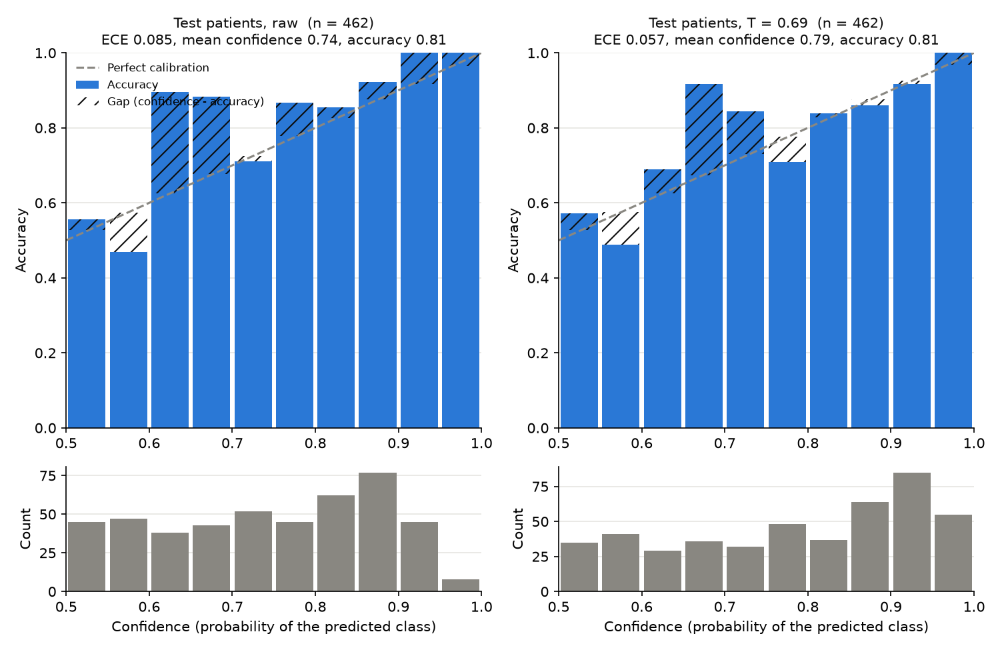

*Figure 8. ConvNeXt-T seed 0, test scans: before (left) and after (right) temperature scaling fitted on validation.*

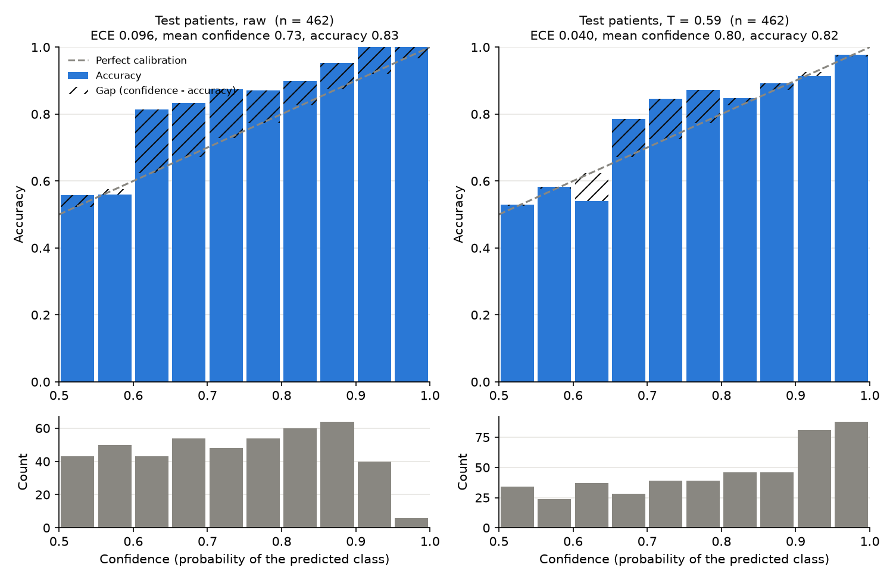

*Figure 9. The baseline CNN, same procedure.*

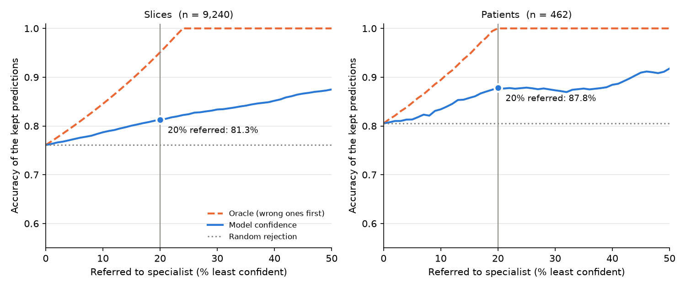

*Figure 10. ConvNeXt-T seed 0: accuracy of the scans the model keeps as the least-confident ones are referred, against an oracle that refers the wrong ones first and random referral (flat).*

**Findings.**
1. **Both models are under-confident at scan level** before calibration (T < 1 for every model): averaging 20 slices pulls each scan's probability towards 0.5. Temperature scaling fitted on validation roughly halves the patient-level ECE and transfers to test, at the price of worse slice-level calibration.
2. **Confidence:** Correct predictions are more confident than wrong ones by only ~0.12, and referring the least-confident 20% raises accuracy by 7 points for both models. However, half of all errors are still made confidently. Suggesting the model only partly knows when it is unsure.
3. **ConvNeXt is not better at knowing when it is unsure than the baseline**: the baseline has the lowest calibrated ECE, the largest confidence gap and the best reject curve. 


### 6.3 Computational efficiency

Measured with one RTX 3080:

| Model | Parameters | Weights | Peak training VRAM | Training time (18 epochs) | GPU latency / scan | GPU throughput | CPU latency / scan |
|---|---|---|---|---|---|---|---|
| Baseline CNN | **0.39 M** | **1.5 MB** | **1.9 GB** | **4 min** | **2.9 ms** | **7,200 slices/s** | **142 ms** |
| ConvNeXt-Nano (BN) | 15.0 M | 57 MB | 3.3 GB | 10 min | 9.9 ms | 2,100 slices/s | 321 ms |
| ConvNeXt-T (BN) | 27.8 M | 106 MB | 5.2 GB | 15.5 min | 16.3 ms | 1,300 slices/s | 648 ms |
| ConvNeXt-T (LayerNorm) | 27.8 M | 106 MB | 5.7 GB | 18.5 min | 18.9 ms | 1,100 slices/s | 537 ms |

All models comfortably meet the resource criterion, but ConvNeXt-T costs **~70x the parameters, ~4x the training time and ~5.6x the GPU latency** of the baseline for no measurable gain in accuracy or calibration.

### 6.4 Qualitative error analysis

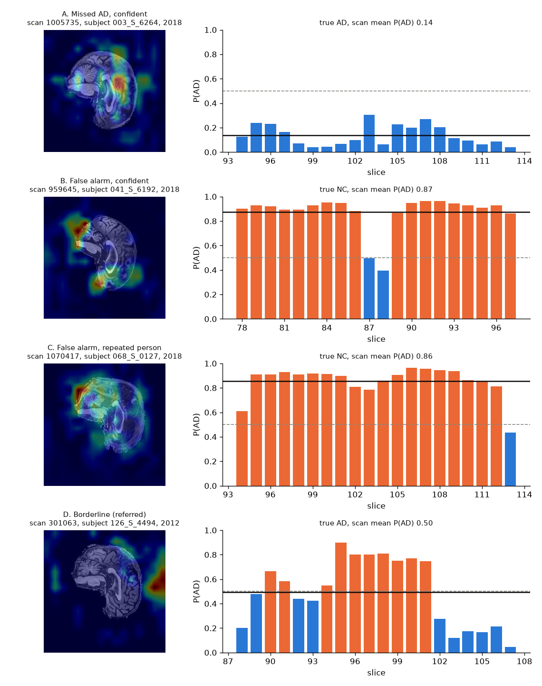

*Figure 11. Four representative failures of ConvNeXt-T seed 0 (left: middle slice with Grad-CAM [13] for the predicted class, stage 3; right: P(AD) of each of the scan's 20 slices, dashed line = 0.5, solid line = scan mean). Made by `report_figures.py`; the case details and person-level statistics below come from `testscripts/compare_runs.py RUN --failures`.*

| Case | Scan (subject, year) | Truth -> prediction | What happened | Root cause (diagnosis) |
|---|---|---|---|---|
| **A. Confident missed AD** | `1005735` (`003_S_6264`, 2018) | AD -> NC, P(AD) 0.14 | Every slice below P(AD) < 0.31, the same person's scan is also missed later (P(AD) < 0.27) | **Brain Shape/ appearance**: this person's brain looks NC-like to the model on every slice and visit. Grad-CAM appears to look at relevant locations on the brain, so the model attended to plausible anatomy that did not look abnormal. The model may not have learnt all aspect of AD diagnosis.|
| **B. Confident false alarm** | `959645` (`041_S_6192`, 2018) | NC -> AD, P(AD) = 0.87 | 18 of 20 slices called AD | Grad-CAM peaks at the edge of the brain and partly outside it, the same hot spot as correct AD predictions (Figure 13). This might indicate some sort of shortcut (correlated boundary detection with AD) rather than AD symptoms |
| **C. Repeated false alarm** | `1070417` (`068_S_0127`, 2018) | NC -> AD, P(AD) = 0.86 | all 3 of this person's test scans are false alarms | Anatomy looks AD-like, plausibly age-related atrophy (age is not in the metadata, so this cannot be confirmed). Across the test set, 18 of 71 NC people with several scans have every scan flagged (possible shortcut: if people with AD usually had multiple scans, having several scans could itself be associated with AD) |
| **D. Borderline, correctly referred** | `301063` (`126_S_4494`, 2012) | AD -> NC, P(AD) = 0.50 | central slices 0.75–0.90 (AD), outer slices 0.05–0.45 (NC); the mean lands on the boundary | **slice disagreement**: the evidence is in the central slices only; the scan-level mean dilutes it. The referral rule correctly sends this case to a specialist |

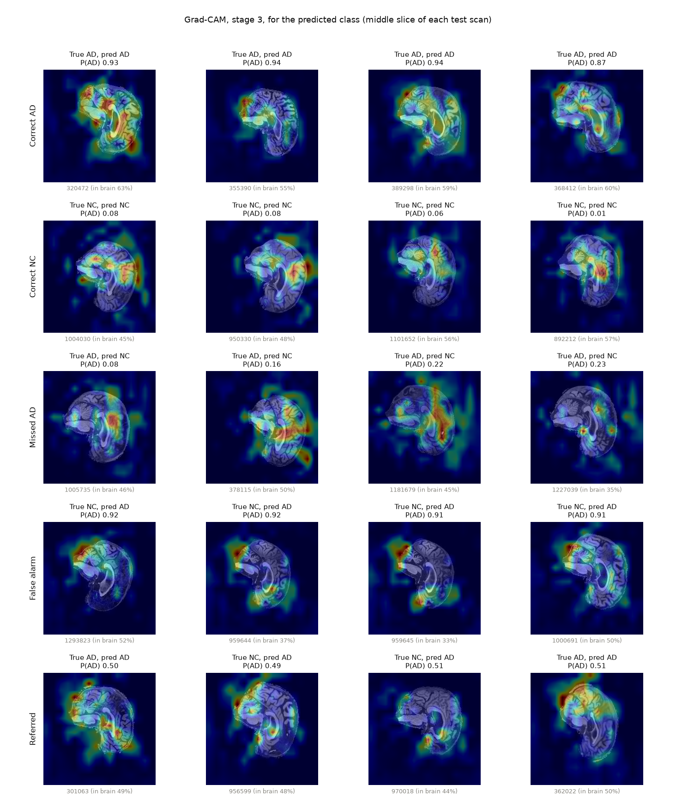

*Figure 12. Grad-CAM (stage 3, predicted class) on the middle slice of test scans per outcome.*

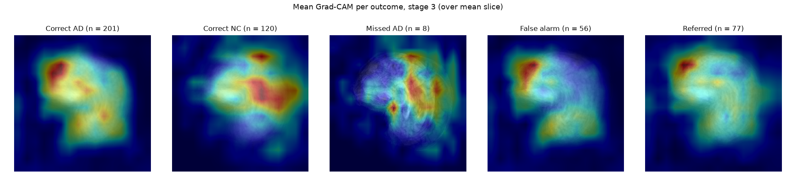

*Figure 13. Mean Grad-CAM per outcome. Correct AD and false alarms share the same frontal hot spot; correct NC predictions focus more centrally.*

**Grad-CAM statistics** (`visualise.py`): on average 47% of each heat map lies inside the (filled) brain outline, which covers 24% of the image. Part of the "outside focus" is the 16 × 16-pixel resolution at stage-3, but the shared frontal hot spot of correct and false AD calls suggests the model also uses the brain's outline. Referred scans have the least focused maps (37% inside).

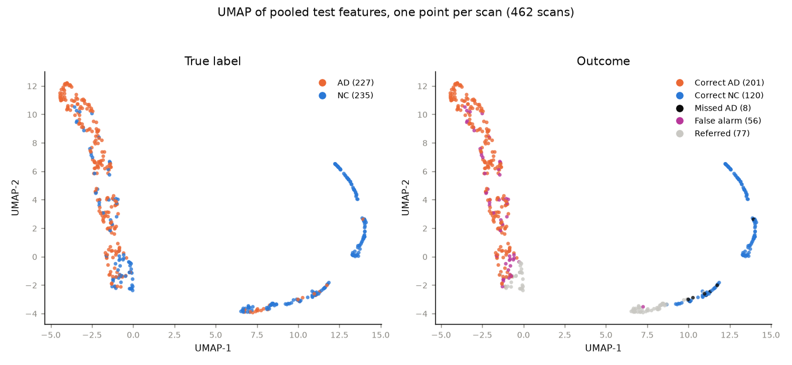

*Figure 14. UMAP [14] of the pooled features (one point per scan). False alarms sit **inside** the AD cluster (confident errors), while referred scans and missed AD lie where the two clusters meet.*

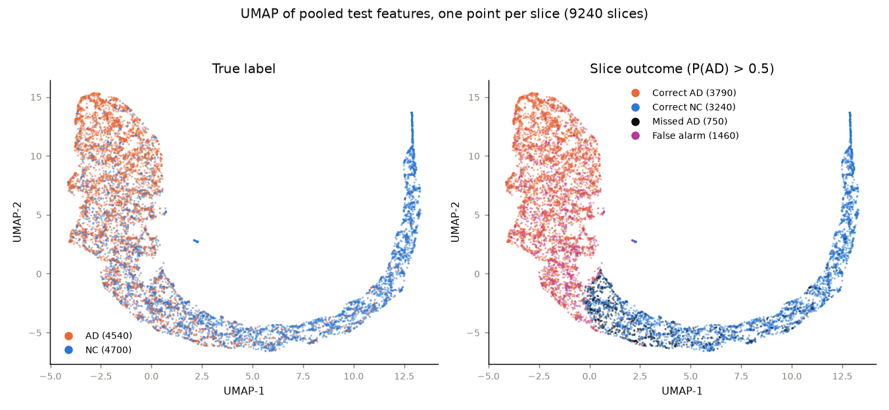

*Figure 15. The same features per slice: a continuous horseshoe from AD-like to NC-like slices with a mixed band where most slice errors fall; averaging 20 slices per scan sharpens the separation (slice accuracy 76.1% -> scan accuracy 80.5%).*

**Summary of failure modes:** 
- Errors are person-level rather than random, a person whose anatomy the model finds AD-like (or NC-like) is continuously misclassified confidiently and are therefore not referred. 
- Slice-level disagreement causes borderline cases, which the referral rule catches.

### 6.5 Engineering recommendation

My engineering recommendations, based on this model's performance, are:

1. **Use the plain CNN, not ConvNeXt, on data of this size.** The 0.39 M-parameter baseline matched ConvNeXt-T in accuracy (82.7% vs 79.4%, not significantly different), calibration and referral performance, at 1/70th of the parameters, ~1/4 of the training time and ~1/6 of the latency.
2. **Decide per scan, not per slice**, by averaging the 20 slices: +3-6 points accuracy and higher AUROC for every model.
3. **Operating rule:** for ConvNeXt-T (seed 0), predict AD if the calibrated P(AD) is above the validation-chosen threshold **0.43**, and refer every scan whose calibrated P(AD) lies within ±0.13 of it (**between 0.30 and 0.56**) to a specialist. On test this referred **16.7%** of scans and raised accuracy from 77.9% to **83.4%**, with **AD recall 0.96**. The baseline's rule, fitted the same way, uses threshold 0.30 with a ±0.10 band (P(AD) between 0.20 and 0.40), 13.9% referred, 87.4% accuracy. Both thresholds are below 0.5, so the rule leans towards calling AD, in line with acceptance criterion 2 (a missed AD is worse than a false alarm). The refferal band is chosen for each model via `calibrate.py` which calculates b so that approximitley 20% of validation scans are referred (acceptance criterion 3). The band is then applied unchanged to test, which is why the test referral rates (16.7% and 13.9%) differ from 20%.
4. **Do not rely on confidence (P(AD)) as the only check:** About half of the errors are confident and there are person-specific (cases A–C). Add an input-quality / out-of-distribution check as a secondary system to detect potential positive cases.
5. **P(AD) classification** Consider referring all scans that have a single slice with P(AD) > the classification threshold.

---

## 7. Usage

### 7.1 Files

| File | Purpose |
|---|---|
| `modules.py` | the models: `ConvNeXt` (LayerNorm, as in the paper), `ConvNeXtBN` (BatchNorm + head dropout), `SimpleCNN` (baseline) |
| `dataset.py` | `build_dataset` (train/val/test) |
| `normalise.py` | `PadToSquare`, training-set mean/std (cached in `stats/`), train and eval transforms |
| `train.py` | AdamW optimiser, `train_one_epoch`, `evaluate`, AD/NC metrics |
| `main.py` | set paramaters for model training|
| `predict.py` | runs a trained checkpoint on the test set or analyses saved predictions: patient-level metrics, confusion matrix, ROC, calibration, reject curve, example predictions |
| `calibrate.py` | temperature scaling, validation-chosen threshold and referral rule |
| `visualise.py` | Grad-CAM and UMAP plots |
| `utils.py` | logging, learning-rate schedule, checkpoint saving/resuming/loading |
| `subject_datasplit.py` | subject-level train/validation/test split (run once) |
| `report_figures.py` | the example input/output and failure-case figures (Figures 11 and 16) |
| `plot_log.py` | training curves and learning-rate plot from `log.txt` |

### 7.2 Running

All commands are run from this folder (`recognition/ConvNeXt_IsabelBarton`). Set the data and output locations once:

```bash
DATA=~/data/ADNI/AD_NC                 # folder containing train/, validation/ and test/
META=~/data/ADNI/meta_data_with_label.json
OUT=~/results/bn_25d_aug_e18           # one new folder per run
```

**1. Create the subject-level split** (alternativley complete your own data split with your own split_manifest.csv). Put every image in `$DATA/train/AD` and `$DATA/train/NC`, leave `validation/` and `test/` empty, preview the split, then run it for real (files are moved, and a `split_manifest.csv` is written):

```bash
python subject_datasplit.py --root $DATA --meta $META --val 10 --test 30             # move the files
```

**2. Train and test the final model** (≈ 15 min on an RTX 3080; needs a CUDA GPU). `main.py` trains, validates every epoch, saves `checkpoint-best.pth` and tests it once at the end:

```bash
mkdir -p $OUT
python main.py \
    --data_path $DATA/train --val_data_path $DATA/validation --eval_data_path $DATA/test \
    --output_dir $OUT \
    --model convnext_tiny_bn --neighbour_slices True \
    --epochs 18 --warmup_epochs 3 --drop_path 0.3 \
    --affine_degrees 15 --affine_translate 0.08 --affine_scale 0.1 \
    --brightness 0.3 --contrast 0.3 \
    --best_metric patient_macro_f1 --seed 0 2>&1 | tee $OUT/train.log
```

Swap `--model` for `simple_cnn` (baseline), `convnext_nano_bn` or `convnext_tiny`, and `--seed` for 1 or 2, to reproduce the other runs. For a quick smoke test, add `--epochs 1 --warmup_epochs 0` with a new `--output_dir`. If a run's `--output_dir` already holds checkpoints, `main.py` resumes from the latest one, so use a new folder for every run.

**3. Analyse the test predictions and plot the training curves:**

```bash
python predict.py --predictions $OUT/test_predictions.csv --output_dir $OUT   # patient level, confusion matrix, ROC, calibration, reject curve
python plot_log.py $OUT                                                         # training curves and learning-rate schedule
```

**4. Calibrate, then visualise:**

```bash
python calibrate.py --resume $OUT/checkpoint-best.pth   # temperature, threshold and referral rule (into $OUT/calibrate)
python visualise.py --resume $OUT/checkpoint-best.pth   # Grad-CAM and UMAP (into $OUT/visualise)
```

**5. Test a trained model again** (re-runs the model on the test set, into `$OUT/predict`):

```bash
python predict.py --resume $OUT/checkpoint-best.pth
```

`python main.py --help` lists all training options (model, learning rate, epochs, augmentation strengths, data paths, checkpoint metric).

### 7.3 Example inputs and outputs

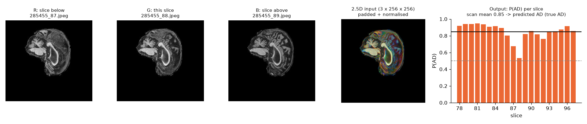

*Figure 16. Input: three neighbouring slices of a test scan become the R, G and B channels of one padded, normalised 3 × 256 × 256 tensor. Output: P(AD) for each of the scan's 20 slices; their mean (0.85) gives the diagnosis AD (correct). Made by `report_figures.py`.*

A run writes to its output folder:

| Output | Contents |
|---|---|
| `log.txt` | one JSON line per epoch: training loss/accuracy/lr, validation loss, accuracy, AD/NC recall and patient-level metrics |
| `test_results.json` | test accuracy, loss, recalls, precisions, macro-F1, confusion counts, best epoch, training time, peak VRAM, parameters |
| `test_predictions.csv` | one row per slice: `path,label,pred,prob_AD,prob_NC` |
| `patient_predictions.csv`, `patient_results.json` | one row per scan (mean P(AD), prediction) and scan-level metrics |
| `confusion_matrix.png`, `roc_curve.png`, `reliability_diagram.png`, `reject_curve.png`, `example_predictions.png` | test-set plots |
| `training_curves.png`, `lr_schedule.png` | training plots |
| `calibrate/`, `visualise/` | calibration results and Grad-CAM / UMAP figures |


---

## 8. Dependencies and Reproducibility

### 8.1 Dependencies

Tested with Linux (kernel 7.0), NVIDIA driver 580.178.04, CUDA 13.0, one RTX 3080 (10 GB):

| Package | Version | Used for |
|---|---|---|
| Python | 3.14.8 | |
| PyTorch | 2.14.1| models, training |
| torchvision | 0.29.1 | datasets, transforms |
| timm | 1.0.30 | `DropPath`, label-smoothing loss, random erasing, `accuracy` |
| NumPy | 2.5.4 | statistics, schedules |
| Pillow | 13.0.0 | image loading |
| matplotlib | 3.11.2 | plots |
| umap-learn | 0.5.12 (with scikit-learn 1.9.1, numba 0.68.0) | UMAP only |

```bash
pip install torch==2.14.1 torchvision==0.29.1 --index-url https://download.pytorch.org/whl/cu130
pip install timm==1.0.30 numpy==2.5.4 pillow==13.0.0 matplotlib==3.11.2 umap-learn==0.5.12
```

---

## 10. Artificial Intelligence Usage Disclosure

- **Tool used:** Claude (Anthropic), through the Claude Code command-line assistant.
- **What it assisted with:**
  - comparing this implementation with a public reference implementation [2] and with Basereh et al. [5];
  - scaffolding and refactoring code: the BatchNorm ConvNeXt variant, the 3-channel neighbouring-slice input, the smaller ConvNeXt sizes and the baseline CNN, `calibrate.py` (temperature scaling, threshold and referral rule), `visualise.py` (Grad-CAM, UMAP), the confusion-matrix/ROC/learning-rate plots, and a final code clean-up;
  - analysis scripts: the patient-leakage investigation from the ADNI metadata;
  - restructuring and formatting this README and condensing the feasibility review.
- **How it was audited and verified:**
  - every experiment was run by me on my own GPU, and every number in this report was read from the run's own output files (`test_results.json`, `log.txt`, `calibration_results.json`);
  - after the code clean-up, every script was re-run, its outputs were checked visually, and they were compared with the outputs from before the clean-up;
  - claims were verified against the academic literature, and [1] was read in depth to fully understand what a ConvNeXt model requires.

---

## References

[1] Z. Liu, H. Mao, C.-Y. Wu, C. Feichtenhofer, T. Darrell, and S. Xie, "A ConvNet for the 2020s," in *Proc. IEEE/CVF Conf. Computer Vision and Pattern Recognition (CVPR)*, 2022, pp. 11976–11986. [Online]. Available: https://arxiv.org/abs/2201.03545

[2] Meta AI Research, "ConvNeXt: official PyTorch implementation," GitHub repository. [Online]. Available: https://github.com/facebookresearch/ConvNeXt

[3] Alzheimer's Disease Neuroimaging Initiative (ADNI). [Online]. Available: http://adni.loni.usc.edu

[5] M. Basereh, M. A. Abikenari, S. Sadeghzadeh, T. Dunn, R. Freichel, P. Siddarth, D. Ghahremani, H. Lavretsky, and V. P. Buch, "ConvNeXt-driven detection of Alzheimer's disease: A benchmark study on expert-annotated AlzaSet MRI dataset across anatomical planes," *Diagnostics*, vol. 15, no. 23, Art. no. 2997, 2025, doi: 10.3390/diagnostics15232997. [Online]. Available: https://pmc.ncbi.nlm.nih.gov/articles/PMC12691013/

[6] M. R. Vyas, "NeuroScan (adni_code)," GitHub repository. [Online]. Available: https://github.com/MeetRVyas/adni_code

[7] W. Jin, Y. Yin, J. Bai, and H. Zhen, "CA-ConvNeXt: Coordinate attention on ConvNeXt for early Alzheimer's disease classification," in *Intelligence Science IV*, IFIP Advances in Information and Communication Technology. Cham, Switzerland: Springer, 2022, pp. 450–457, doi: 10.1007/978-3-031-14903-0_48. [Online]. Available: https://link.springer.com/chapter/10.1007/978-3-031-14903-0_48

[8] M. Basereh *et al.*, "ConvNeXt-driven detection of Alzheimer's disease: A benchmark study on expert-annotated AlzaSet MRI dataset across anatomical planes," bioRxiv preprint, Jul. 2025, doi: 10.1101/2025.07.10.664260. [Online]. Available: https://www.biorxiv.org/content/10.1101/2025.07.10.664260v1.full

[9] M. Basereh, "AlzaSet: MRI dataset for 'ConvNeXt-driven Alzheimer's detection: A benchmark study on expert-annotated AlzaSet MRI dataset across anatomical planes'," Zenodo, version v2, 2025, doi: 10.5281/zenodo.17084199. [Online]. Available: https://zenodo.org/records/17084199

[10] R. Müller, S. Kornblith, and G. E. Hinton, "When does label smoothing help?," in *Advances in Neural Information Processing Systems (NeurIPS)*, vol. 32, 2019. [Online]. Available: https://arxiv.org/abs/1906.02629

[11] G. Xia, O. Laurent, G. Franchi, and C.-S. Bouganis, "Towards understanding why label smoothing degrades selective classification and how to fix it," in *Proc. Int. Conf. Learning Representations (ICLR)*, 2025. [Online]. Available: https://arxiv.org/abs/2403.14715

[12] C. Guo, G. Pleiss, Y. Sun, and K. Q. Weinberger, "On calibration of modern neural networks," in *Proc. Int. Conf. Machine Learning (ICML)*, 2017, pp. 1321–1330. [Online]. Available: https://arxiv.org/abs/1706.04599

[13] R. R. Selvaraju, M. Cogswell, A. Das, R. Vedantam, D. Parikh, and D. Batra, "Grad-CAM: Visual explanations from deep networks via gradient-based localization," in *Proc. IEEE Int. Conf. Computer Vision (ICCV)*, 2017, pp. 618–626. [Online]. Available: https://arxiv.org/abs/1610.02391

[14] L. McInnes, J. Healy, and J. Melville, "UMAP: Uniform manifold approximation and projection for dimension reduction," arXiv:1802.03426, 2018. [Online]. Available: https://arxiv.org/abs/1802.03426

[15] S. Ioffe and C. Szegedy, "Batch normalization: Accelerating deep network training by reducing internal covariate shift," in *Proc. Int. Conf. Machine Learning (ICML)*, 2015, pp. 448–456. [Online]. Available: https://arxiv.org/abs/1502.03167

[16] S. Santurkar, D. Tsipras, A. Ilyas, and A. Madry, "How does batch normalization help optimization?," in *Advances in Neural Information Processing Systems (NeurIPS)*, vol. 31, 2018. [Online]. Available: https://arxiv.org/abs/1805.11604

[17] M. Raghu, C. Zhang, J. Kleinberg, and S. Bengio, "Transfusion: Understanding transfer learning for medical imaging," in *Advances in Neural Information Processing Systems (NeurIPS)*, vol. 32, 2019. [Online]. Available: https://arxiv.org/abs/1902.07208

[18] I. Loshchilov and F. Hutter, "Decoupled weight decay regularization," in *Proc. Int. Conf. Learning Representations (ICLR)*, 2019. [Online]. Available: https://arxiv.org/abs/1711.05101

[19] G. Huang, Y. Sun, Z. Liu, D. Sedra, and K. Q. Weinberger, "Deep networks with stochastic depth," in *Proc. European Conf. Computer Vision (ECCV)*, 2016, pp. 646–661. [Online]. Available: https://arxiv.org/abs/1603.09382

[20] Z. Zhong, L. Zheng, G. Kang, S. Li, and Y. Yang, "Random erasing data augmentation," in *Proc. AAAI Conf. Artificial Intelligence*, 2020, pp. 13001–13008. [Online]. Available: https://arxiv.org/abs/1708.04896

[21] R. Wightman, "PyTorch Image Models (timm)," GitHub repository, 2019. [Online]. Available: https://github.com/huggingface/pytorch-image-models

[22] B. Lakshminarayanan, A. Pritzel, and C. Blundell, "Simple and scalable predictive uncertainty estimation using deep ensembles," in *Advances in Neural Information Processing Systems (NeurIPS)*, vol. 30, 2017. [Online]. Available: https://arxiv.org/abs/1612.01474
